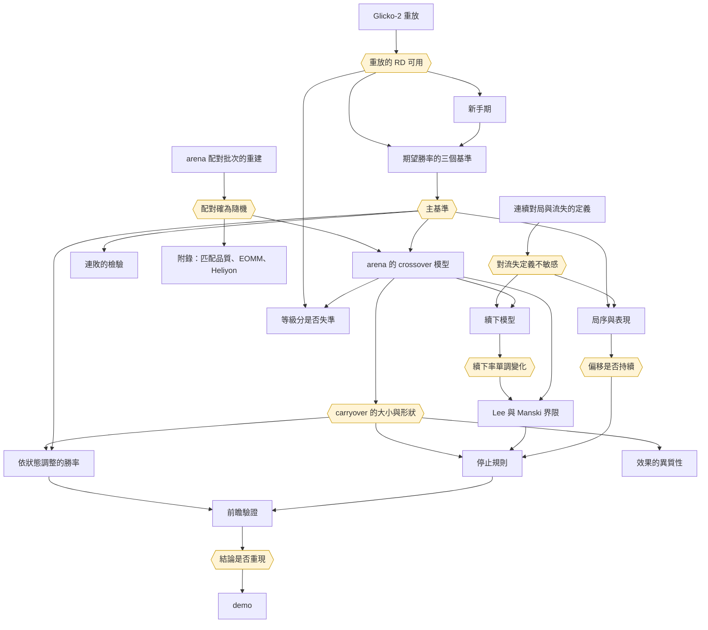

# 分析計劃

依研究問題排列的方法、各方法的定位、結論之間的依賴、進度與待辦。研究問題見 `docs/design.md`；各方法的模型、假設、升級規則與統計依據見 `docs/methods.md`。

## 框架

- **推論的依據**：主問題的因果推論只依賴 2014 年 arena 已知的隨機配對機制，以批內 permutation test 推論；模型只用來提高精度與換算效果的大小
- **檢定的優先序**：概似比檢定優先，其次 score 檢定，最後 Wald 檢定；資料有玩家與 dyadic 相依時用修正版。信賴區間可用 delta method（`docs/methods.md`「檢定與區間」）
- **方法的定位**：每個方法屬主要做法、對照、條件保留、退路之一。條件保留與退路的觸發條件事先寫在 `docs/methods.md`「方法的升級規則」，不看結果再挑方法
- **基礎方法優先**：基礎方法通過診斷即不升級；有更簡單而同樣嚴謹的做法時不用複雜模型（`docs/methods.md`「不採用的方法」）
- **停止的決策與因果的解讀分開**：停止規則只需要預測力，以回測評估，選擇問題由「只刪局」的性質處理；「剛輸使下一局變差」這個因果解讀只依據隨機配對。機器學習只用於預測
- **前瞻驗證只用一次**：2015 年 1 月 1 日至 4 月 19 日的 arena，動用前寫定並 commit 登記文件

## 研究問題與方法

### 地基：資料與定義

| 項目 | 回答 | 狀態 | 文件 |
|---|---|---|---|
| 連續對局與流失的定義 | 續下、離開、回訪的操作定義 | 已完成 | `docs/sessions.md` |
| arena 配對批次的重建 | 每次配對時同時空閒的玩家；permutation test 的打亂範圍 | 已完成 | `docs/random-pairing.md` |
| Glicko-2 重放 | 每局對局前的 rating deviation | 已完成 | `docs/glicko-replay.md` |
| 速度類別 | 等級分屬於哪一個類別 | 已完成 | `docs/speed-class.md` |
| 新手期 | 等級分尚未收斂的對局如何界定 | 已完成 | `docs/novice-period.md` |
| 配對來源與對局時間 | `source` 與對局結束時間 | 進行中 | `data/raw/lichess-game-meta/` |

### 期望勝率是否校準

三個基準：有序 logistic、Glicko 形式、加入 rating deviation 的有序 logistic。

| 定位 | 方法 |
|---|---|
| 主要做法 | 三者巢狀於加入 rating deviation 的模型，以 dyadic 相依修正的概似比檢定比較；proportional odds 以 partial proportional odds 的概似比檢定 |
| 對照 | 樣本外對數分數與 ranked probability score，差值的標準誤用 dyadic sandwich；Bradley–Terry–Davidson 模型 |
| 退路 | sandwich Wald 檢定 |

- **Glicko 形式的收縮**：用雙方 RD 的合成（`docs/methods.md`「期望勝率的三個基準」）
- **決策點**：主基準已定為加入 RD 的有序 logistic，另兩者作敏感度分析；寫進登記文件
- **輸出**：各基準的勝、和、負機率；Elo 形式哪裡偏（`docs/expected-score-baselines.md`）

### 剛輸之後，期望勝率是否又錯一層

兩個目標量：總效果含 arena 中上一局經由下一局對手的管道；直接效果固定下一局的對手，類推到排隊配對時用它。以玩家加權為主、以局加權為次。規格見 `docs/methods.md`「arena 的 crossover 模型」。

| 定位 | 方法 |
|---|---|
| 主要做法 | 總效果：上一局所屬批內重新配對的 permutation test |
| 主要做法 | 直接效果：基準變數自由估計的有序 logistic，殘差做玩家內對比，配對 $t$ 檢定 |
| 主要做法 | 輸棋本身的效果（平均得分差的比值）；勝負兩邊的對稱性 |
| 對照 | 玩家斜率的 $t$ 檢定；以局加權的修正概似比檢定與玩家 bootstrap；玩家隨機截距的 GLMM；只用純隨機規則的批；CMH 與 Mantel–Haenszel |
| 條件保留 | spline 的劑量反應：linear-by-linear 趨勢檢定顯示偏離線性時 |

- **前置**：主基準；配對批次
- **輸出**：總效果、直接效果與輸棋本身的效果，換算成等級分；劑量反應的形狀（`docs/crossover.md`）

### 續下的選擇

下一局的表現只在續下時才有定義（truncation by death），目標量是兩種對手強弱下都會續下的玩家的效果。

| 定位 | 方法 |
|---|---|
| 主要做法 | 續下模型：本場內是否再開一局的 logistic 迴歸，只取距結束仍有足夠時間的局 |
| 主要做法 | Lee 界限 |
| 對照 | Manski 界限；inverse probability weighting（假設會把 tilt 一併假設掉，只作此假設下的答案）；有參數的敏感度分析 |
| 描述 | 從對局結束起算的競爭風險 hazard：剛輸的人是否隔較久才開下一局 |

- **前置**：crossover 模型；hazard 需要 API 的對局結束時間
- **決策點**：續下率是否隨上一局對手強弱單調變化，決定 Lee 界限能否用；界限的寬度決定多局 carryover 報告到第幾局
- **輸出**：效果的上下界

### 等級分在剛輸之後是否失準

Glicko 的等級分是事後平均，濾波器設定正確時不會在剛輸之後系統性低估。問題因此是濾波器是否失準。

| 定位 | 方法 |
|---|---|
| 主要做法 | 依 RD 與上一局結果分層的 Cox 校準截距與斜率 |
| 主要做法 | 以不同的 volatility 參數 τ 重放 Glicko，看 carryover 如何改變 |

- **前置**：重放；crossover 模型
- **輸出**：carryover 中有多少可能來自濾波誤差；隨機配對分不開 tilt 與濾波誤差，報告須說明

### 局序與表現

| 定位 | 方法 |
|---|---|
| 主要做法 | pattern-mixture：依連續對局的最終長度分組，看組內各局的平均殘差 |
| 條件保留 | 固定長度組內的貝氏變點模型：曲線有明顯轉折時 |

- **前置**：基準；連續對局的定義
- **決策點**：偏移是否持續，決定停止規則是否加入 CUSUM

### 依狀態調整的勝率（預測）

| 定位 | 方法 |
|---|---|
| 主要做法 | 基準加上一局結果一項的有序 logistic |
| 主要做法 | GAM：spline 與前幾局結果的滯後項，檢查非線性與較長的歷史 |
| 對照 | LightGBM，作為預測上限；在校準樣本上以 cumulative logit 重新校準 |

- **前置**：基準；crossover 模型
- **評估**：2014 年依時間分成估計、驗證、校準三段
- **輸出**：修正後的勝、和、負機率

### 停止規則

| 定位 | 方法 |
|---|---|
| 主要做法 | 回測：事先寫定的規則（一路下到第一次輸、爆冷輸才停、連輸兩局才停、從不停、最適規則）套到實際序列，比較保留與刪去的局的平均殘差；玩家 block bootstrap；多條規則以 Romano–Wolf 的逐步檢定控制 |
| 主要做法 | 隔天重置：刪去的局與隔天第一局的殘差比較；第一局作為探測：第一局的殘差是否預測當天其餘各局 |
| 主要做法 | Markov chain 上以動態規劃求最適停止規則，判準為每局的期望殘差；吸收鏈的精確解，bootstrap 傳遞參數誤差 |
| 條件保留 | risk-adjusted 的多項分布 CUSUM：局序與表現顯示偏移會持續時 |
| 退路 | Monte Carlo：狀態空間大到無法精確計算時 |

- **前置**：crossover 模型；續下模型；局序與表現
- **輸出**：民間規則有沒有用、爆冷輸才停是否更好；依速度類別的停止規則；簡單規則與最適規則的差距

### 前瞻驗證

- **登記文件**：主基準、檢驗的量、判定規則、檢定水準與方向、最小可偵測效果與檢定力
- **判定規則**：2015 年的總效果以單尾檢定拒絕「效果不在 2014 年的方向」，且兩年的效果以同質性檢定不拒絕，並報告兩年差值的信賴區間
- **檢驗的量**：總效果；依狀態調整的勝率的對數分數；採用 CUSUM 時其誤報率與偵測速度

### demo

- 修正後的勝、和、負機率與「再開一局，預期低於平常多少」；以 2015 年前瞻資料的匿名對局重播
- 只在前瞻驗證通過後，把停止規則作為建議呈現

### 附屬

| 問題 | 主要做法 | 條件保留 |
|---|---|---|
| 連勝與連敗是否超出期望 | 依主基準機率的 parametric bootstrap，停止時點以續下模型一併模擬；統計量為長度至少 k 的連勝與連敗次數及兩者的不對稱，k 事先指定、Holm 校正；以期望得分分層的 3×3 表檢驗一階相依 | 排除每段連續對局最後一局的敏感度分析 |
| 效果在玩家間的差異 | 依速度類別、等級分區間分組，交互作用的概似比檢定 | 隨機斜率的 GLMM 與邊界上的概似比檢定；求積失敗時改用階層貝氏 |
| 輸後的 rematch | 實測局數與誰提出 | 樣本與選擇撐得起時才納入 |

### 附錄

| 分析 | 狀態 |
|---|---|
| 隨機配對下匹配品質的效果 | 已完成（`docs/match-quality-leave.md`）；對局長度的機械效果待 API 的對局結束時間，以 hazard 模型分解 |
| EOMM 關鍵假設的檢驗 | 已完成（`docs/eomm-assumption.md`） |
| Heliyon 模型的複製與比較 | 已完成（`docs/fixed-effects-churn.md`），是否入附錄未定 |

已完成的三項與校準中作決策的檢定已改為修正的概似比檢定重跑，結論皆未改變。

### 延伸

- **AoE2 的外部效度**：有餘裕時。排隊配對不隨機，只作相關的比對
- **pool 與 arena 的連勝連敗對照**：有餘裕時。先實測 pool 的局數與玩家數，樣本撐得起才做。pool 依近期戰績配對，arena 隨機，兩者的連勝連敗與期望的差距可作「系統依戰績安排」與「系統不安排」的對照。限制：pool 等級分自成一套、只有四個月、玩家自選進入 pool，兩者的差距混有情境差異，只作描述

## 結論之間的依賴

每個結論都有成立與不成立兩種走向，計劃須兩邊都備妥。

### 會影響其他方法的結論

| 結論 | 由哪個方法得出 | 影響的方法 |
|---|---|---|
| 配對確為隨機 | 配對批次的重建 | crossover 模型、Lee 界限、附錄 |
| 主基準 | 三個基準 | 幾乎所有方法：表現的基準、勝和負機率、連敗的虛無模型 |
| 重放的 RD 可用 | Glicko-2 重放 | 新手期、三個基準、等級分是否失準 |
| carryover 是否不為 0、是否線性 | crossover 模型 | 依狀態調整的勝率、停止規則看「輸」或「爆冷輸」 |
| 續下率是否隨對手強弱單調變化 | 續下模型 | Lee 界限能否用 |
| 界限的寬度 | Lee 界限 | 多局 carryover 能報告到第幾局 |
| 偏移是否持續 | 局序與表現 | CUSUM 是否採用 |
| 濾波器在剛輸之後是否失準 | 等級分是否失準 | carryover 的解讀 |
| 改用修正的概似比檢定後結論是否改變 | 已完成分析的重跑 | 已得出的結論 |
| 2014 年的結論是否重現 | 前瞻驗證 | 停止規則與 demo 能否作為建議 |

### 各方法在結論成立與不成立時的走向

| 方法 | 依賴的結論 | 成立時 | 不成立時 |
|---|---|---|---|
| crossover 模型 | 配對確為隨機 | 兩局以上的批以 permutation test 推論 | 一局一批以「下完的時間與等級分無關」為前提，與隨機化推論分開陳述 |
| | 平衡檢驗不拒絕 | 用全部兩局以上的批 | 自身等級分放進模型，以只用純隨機規則的批為敏感度分析 |
| | 上一局不影響下一局的對手 | 總效果即直接效果 | 兩者分開報告，類推到排隊配對的是直接效果 |
| | 三個基準的結論一致 | 報告主基準，另兩者為敏感度分析 | 如實寫出結論依賴基準 |
| 依狀態調整的勝率 | carryover 不為 0 | 加入上一局結果一項 | 修正後的勝率即基準本身；demo 只給基準的勝率 |
| 停止規則 | carryover 不為 0 | 求最適規則並與簡單規則比較 | 規則間的差異只來自期望勝率的錯估；建議為「輸了不必停」 |
| | carryover 隨對手強弱線性 | 規則看輸贏 | 規則只看爆冷輸 |
| | 偏移持續 | 加入 CUSUM | 不採用 CUSUM |
| Lee 界限 | 續下率單調變化 | 報告 Lee 界限 | 只報告 Manski 界限 |
| 多局 carryover | 界限仍有資訊 | 報告前一至三局 | 只報告到界限仍有資訊的局數 |
| 貝氏變點模型 | pattern-mixture 曲線有明顯轉折 | 在固定長度的組內估計轉折位置 | 不做 |
| 效果的異質性 | 組間交互作用的概似比檢定不拒絕 | 只報告分組結果 | 隨機斜率的 GLMM |
| 連敗的 bootstrap | 期望勝率校準 | 以校準後的機率模擬 | 修正後仍不校準時，連敗的「異常」可能只是基準失準，結論不採 |
| AoE2 的外部效度 | carryover 不為 0 | 檢驗排隊配對中是否同向 | 只作描述 |

### 已得出的結論

| 結論 | 結果 | 所走的路 | 依據 |
|---|---|---|---|
| 期望得分校準 | 不成立：Elo 形式系統性高估強方優勢，老手也一樣；白方有固定優勢；和局機率隨等級上升 | 匹配品質 $q$、勝和負機率、連勝的虛無模型、表現的基準一律改用有序模型的校準期望得分；新手對局排除或讓斜率依累計局數變化。偏差的來源待分解：等級分是 Glicko 濾波器的事後平均，量測誤差屬 Berkson 型，不會使斜率衰減，所以候選來源是濾波器的設定讓等級分過度反應；Glicko-2 重放因此是解釋偏差的必要工作，但不阻擋主分析 | `docs/calibration.md` |
| 配對確為隨機 | 成立，但結構與預期不同：錦標賽第一批之後，絕大多數批次只有兩人同時空閒、只能配成一局，批內沒有可打亂的配法；空閒超過 12 人幾乎只發生在第一批 | randomization inference 只用兩局以上的批次（設計上的隨機）；12 人以下的批以「不含重複對手的配法中均勻抽出」為精確虛無分布；一局一批的配對以「下完的時間與等級分無關」為前提作模型化分析，與隨機化推論分開陳述。退路「只用空閒超過 12 人的批次」不可行 | `docs/random-pairing.md` |
| 對流失定義不敏感 | 大致成立：門檻改變續下率的高低，但除了和局相對於勝負的位置外，描述結論的方向不變 | 以主門檻為主定義，另以主門檻的一半與兩倍重做主要估計；8 小時與 14 天的定義不依賴門檻，直接並列；涉及和局的結論須報告各門檻 | `docs/sessions.md` |
| 新手期的門檻 | 主定義為任一方重放 RD ≥ 110（Lichess 自 2015 年 6 月起標示 provisional 的門檻；2014 年的程式碼沒有這個概念）。RD 門檻約略等於固定的局數，與累計局數的代理高度一致；但校準斜率在 110 處沒有斷點，隨 RD 下降連續上升，到更低的 RD 才趨穩，門檻是約定而非資料的轉折點 | 新手的偏差以加入 RD 的基準吸收，門檻只用於描述與限樣本的敏感度分析；敏感度取 RD ≥ 100 與雙方累計局數皆至少 30 局。arena 的新手對局占比高於 lobby，處理新手對主問題較重要 | `docs/novice-period.md` |
| 匹配品質的總效果 $\gamma$ | 不為 0：隨機配對下，配對越懸殊，短時間窗內的離開越少，兩層識別一致。須以期望匹配品質 $\bar q$ 校正：等級分在候選者中越極端，$q$ 不論配到誰都偏大。效果有一大部分來自懸殊的對局下得較短，時間窗越短效果越大；8 小時離開的效果小，只用純隨機的批時不顯著 | 續下改以「本場內是否再開一局」的二元結果為主，只取距結束仍有足夠時間的局，不受時間窗與對局長度影響；hazard 只作描述與附錄的機械效果分解；「越懸殊越少離開」不可解讀為玩家偏好懸殊的配對 | `docs/match-quality-leave.md` |
| 給定結果的直接效果與勝和負不等式 | 關鍵假設不成立：給定本局結果，分差仍影響離開（贏棋後越懸殊越少離開；爆冷輸後離開最多）。$c(\text{勝}) + c(\text{負}) - 2c(\text{和})$ 為正，但假設既不成立，不能推出等實力配對最佳 | 放附錄；主問題的續下模型同樣納入分差與「結果 × 分差」 | `docs/eomm-assumption.md` |
| Heliyon 模型的比較 | 可複製且多數方向可解讀；arena 的分差係數大於大廳，差距的信賴區間不含 0。但大廳的估計對控制自身等級分敏感，控制後直接效果變號，玩家固定效應處理不了等級分起落的混淆；每位玩家的觀察日數少，固定效應 logit 的 incidental parameters 偏誤明顯，效果大小以 conditional logit 為準 | 「觀察資料加固定效應」在自選對手的情境下不可靠，這是本研究對電競文獻的方法論結論之一；14 天流失的玩家日模型與逐局的隨機配對分析，反應變數、單位與樣本都不同，不能互相驗證 | `docs/fixed-effects-churn.md` |
| 重放重現表頭 | 成立，但須以表頭校正：資料始於 2013 年，此前的 rated 對局不在資料中，從 1500 起的純重放大多不相符；改為每局與表頭取交集、不相容時以表頭重設後，Bullet、Blitz、Classical 絕大多數相符。RD 與 volatility 完全照 lila 的規則重放，以重放的 RD 預測表頭的 RatingDiff 幾乎完全相同 | 重放的 RD 可用於 Glicko-2 形式的期望得分與 provisional 定義的新手期；不相符集中於左截斷帳號的前段、2014 年 pool 試行期的 Bullet 與 Blitz、線上期間的 Classical 與通信棋，這些範圍內的 RD 須謹慎使用 | `docs/glicko-replay.md` |
| 速度類別的修正 | 結論不變：月檔的時間類別是匯出時事後標記的，2015 年 4 月下旬以前部分有加秒的大廳對局被標到慢一級的類別；arena 對局不受影響。各分析改依重放判定的速度類別（`speed`）重跑，主要結論皆未改變 | 後續分析一律依 `speed` 分組；`time_class` 只留作對照 | `docs/speed-class.md` |
| 修正的概似比檢定的檢定水準 | 有效玩家數到數千時接近名目水準；有效玩家數少時仍偏寬鬆。Blitz、Classical 的真實樣本落在接近名目水準的範圍，Bullet 略為寬鬆 | 修正的概似比檢定作為主要做法；Bullet 上接近顯著邊緣的結果須保留，必要時改用小樣本修正的 sandwich | `docs/expected-score-baselines.md` |
| 改用修正的概似比檢定後的結論 | 校準、EOMM 關鍵假設、Heliyon 的階段與 Mundlak 檢定的結論皆未改變；獨立假設下的 p 值普遍過小 | 已得出的結論照舊；`scripts/speed_fix_effect.py` 的修正前後比較仍以 Wald 為準，不重跑 | `docs/calibration.md`、`docs/eomm-assumption.md`、`docs/fixed-effects-churn.md` |
| 期望勝率的三個基準 | 有序 logistic 與 Glicko 形式對加入 RD 的有序 logistic 都被拒絕；加入 RD 的模型在全部、新手、老手三組的樣本外表現都最好；RD 的收縮比 Glicko 的式子更強 | 主基準定為加入 RD 的有序 logistic，另兩者作敏感度分析；新手對局留在主樣本，由基準吸收 | `docs/expected-score-baselines.md` |
| 剛被分到強對手之後的 carryover | Bullet 沒有證據；Blitz 的總效果成立、只延續一局，直接效果的主要檢定方向相同但不顯著，連續 $h$ 的對照顯著。上一局的配對會改變下一局的對手，總效果含這條 arena 特有的管道 | 依狀態調整的勝率只在 Blitz 加入上一局一項；類推到排隊配對時只能說直接效果方向一致、未能確立；結論都只在續下者上，須經 Lee 界限 | `docs/crossover.md` |

這些結論帶出的待查事項：

- **2014 年 11 月底起，一局一批的重複對手驟降為零**：此前大型錦標賽也有重複對手，與原始碼的規則不符；`PairingSystem.scala` 在這段期間沒有修改，可能與錦標賽後端改寫的上線時間有關。若屬實，2014 年的配對機制以 11 月底為界分兩段，須分段檢驗
- **一局一批中執子顏色的輕微偏向**：白方等級分較高的比例略高於一半，原始碼看不出原因，可能與被中止的對局不在資料中有關
- **對局長度的機械效果與總效果的分離**：目前只有每場錦標賽第一局的對局長度（API 的 `createdAt` 與 `lastMoveAt`）。要在所有隨機配對的批次上分開機械效果，須逐局向 API 取得
- **大廳對局仍含指定邀戰與疑似 pool 的對局**：校準與流失定義的「一般對局」都未區分，須以 API 的 `source` 分開後重估

### 依賴圖

方框為方法，六角形為會影響其他方法的結論。

## 進度與待辦

### 已定的原則

- **主問題已定**：期望勝率在哪些情況下錯，與玩家的停止規則（`docs/design.md`）。選題的理由與候選見 `docs/topic-selection.md`
- **術語**：randomization inference 以 permutation test 陳述；conditional logit 與固定效應 logit 以「每組有自己截距的 logistic 迴歸」陳述（`GLOSSARY.md`）。分析者修過的方法見 `~/vault/note`
- **修正的概似比檢定收進共用 module**：dyadic meat 與加權卡方尾機率會在三個基準、校準、EOMM、Heliyon 的腳本中重複使用（`CLAUDE.md` 共用 module 條款）
- **帳號以整數代碼分組與串接**：`lichess_games.parquet` 的 `white_id`、`black_id` 與 `player_games.parquet` 的 `player`、`opponent` 是同一套代碼。以帳號字串分組是先前記憶體不足的主因；帳號名稱只在與 API 資料串接時使用
- **一次只跑一個分析**：一個分析能用滿硬體時依序執行，以 `systemd-run --user --scope -p MemoryMax=20G -p MemorySwapMax=0` 加上執行緒數的環境變數限制。熱點先向量化，再考慮 numba，最後才寫 Rust（rayon、faer、fearless_simd、native 編譯；保留 Python 參考實作）

### 進行中

- **2014 年對局的配對來源與對局時間**：`scripts/fetch/lichess_game_meta.py` 以 systemd unit `lichess-game-meta` 在背景執行，arena 對局先、大廳對局後，可續傳，網路錯誤自動重試，行程失敗時 systemd 自動重啟。進度見 `data/raw/lichess-game-meta/fetch.log`。速率由伺服器限制，帶 token 也不會加快。完成後須補寫 `data/raw/lichess-game-meta/SOURCE.md`

### 待辦（依序）

1. **crossover 模型的其餘對照**：玩家隨機截距的 GLMM、Bradley–Terry–Davidson 模型、錦標賽之後大廳的下一局
2. **續下模型**：本場內是否再開一局；單調性的檢查
3. **界限**：Lee 界限，與 Manski 界限、inverse probability weighting、有參數的敏感度分析並報
4. **等級分是否失準**：依 RD 與上一局結果分層的校準；改變 τ 重放
5. **局序與表現**：pattern-mixture 曲線；有明顯轉折才做變點
6. **依狀態調整的勝率**：有序 logistic、GAM、LightGBM
7. **停止規則**：回測、隔天重置、第一局作為探測、最適規則；偏移持續時加 CUSUM
8. **附屬**：連敗的檢驗、效果的異質性、rematch 的實測
9. **前瞻驗證的登記文件**，之後才動用 2015 年 1 月 1 日至 4 月 19 日的 arena
10. **demo**
11. **附錄**：API 的對局結束時間取得後，以競爭風險 hazard 描述續下，並分解匹配品質效果中的對局長度機械效果
12. **2014 年 pool 的可行性檢查**：pool 依近期淨分配對，是依近況安排對手的實作（`docs/literature.md`「Lichess 的配對機制」）。先只看描述、不看結果變數：pool 時間制的非錦標賽對局數、API 的 `source` 為空的比例、wave 能否由同秒開局重建、同一 wave 內的配對是否符合「淨分排序、相鄰配對」。規則驗證通過才登記研究問題（依近況配對下，連勝連敗與輸贏後的表現是否偏離期望勝率，以 arena 為對照），只放附錄；不通過則只記錄這段事實。需等 API 的 `source` 抓取完成
13. **有餘裕時**：AoE2 的外部效度

## 執行上的判斷

- **先做會左右最多方法的結論**：主基準影響幾乎所有方法；它的比較依賴修正的概似比檢定，所以兩者排在最前面，可並行（見待辦）
- **carryover 是樞紐**：依狀態調整的勝率與停止規則都依賴它的大小與形狀
- **選擇偏誤是評分時會被重點檢視的一環**：inverse probability weighting 的假設會把 tilt 一併假設掉，所以界限為主、IPW 為對照
- **輸棋本身的效果多一個假設**：上一局對手只經由結果影響下一局。附錄的 EOMM 檢驗發現對手經由結果以外的途徑影響離開，這個假設同樣可能不成立，所以總效果為主、比值為解讀
- **tilt 與濾波誤差分不開**：上一局對手強弱同時經由輸贏與等級分更新的幅度影響下一局，結論須以「剛輸之後，系統的期望勝率是否又錯一層」陳述，不宣稱全是心理效果
- **前瞻驗證之前不得反覆修改模型**：2014 年內可反覆，登記之後只跑一次
