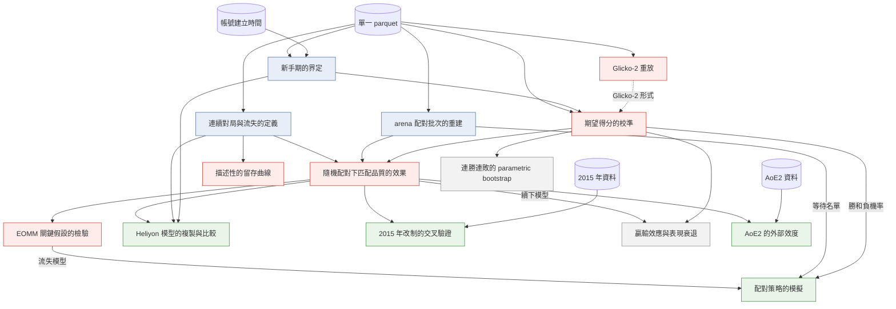

# 分析計劃

各方法要解決的問題、所依賴的前置工作與優先級。研究問題見 `docs/design.md`，文獻出處見 `docs/literature.md`。

## 借用的方法：原論文解決什麼，本研究借它解決什麼

借用時須分清兩件事：原論文用這個方法回答什麼問題、在什麼條件下成立；本研究用它回答什麼，條件是否仍成立。

### EOMM（arXiv 1702.06820）

- **原論文的問題**：「勢均力敵的配對對投入度最好」這個假設是否成立；若不成立，如何配對才能讓總流失最小
- **方法**：把等待配對的玩家視為完全圖，邊的權重是兩人配對後的流失機率之和，以 minimum weight perfect matching 求總流失最小的配對。流失機率分解為 `Pr(結果 | 雙方實力) × Pr(流失 | 自身狀態, 結果)`；後者以 logistic 迴歸估計，特徵為最近 10 局的勝和負、間隔時間與近期局數，流失定義為之後 8 小時不再下 1v1
- **關鍵假設**：給定本局結果，對手的狀態不再影響自己是否流失，即 `c(s_i, s_j, o) = c(s_i, o)`。對手只透過結果影響流失
- **理論結論**：若只有結果影響流失，且 `c(勝) + c(負) > 2c(和)`，等實力配對與 EOMM 等價；反之等實力配對反而最差。若流失只取決於自身狀態，任何配對都與隨機配對一樣
- **原論文的限制**：EA 的資料，配對由系統依實力決定，無法檢驗上述假設；策略比較只能模擬；和局機率固定為 20%，不隨分差變化
- **本研究借它解決**：（一）在 2014 年 arena 的隨機配對下直接檢驗關鍵假設：控制本局結果後，分差是否仍影響流失。（二）以理論結論的不等式判斷等實力配對在 Lichess 上是否最好。（三）在真實的等待名單上模擬不同配對策略，作為系統端建議的依據
- **條件是否成立**：隨機配對使分差與玩家狀態無關，檢驗不受自選混淆。和局機率以校準後的模型取代固定值

### Heliyon 2024（Kang、Suh、Kim）

- **原論文的問題**：配對經驗與對局表現是否導致流失。假設包括：配到較弱的對手降低流失、分差的變異提高流失、勝率與連勝降低流失、連敗提高流失、遊戲階段調節上述效果
- **方法**：玩家日為單位，流失定義為之後 14 天沒有對局。雙向固定效應 logistic 迴歸（玩家、日期），回報平均半彈性；以 Hausman、Wald、概似比檢定與 BIC 選模型；依改版前後、活躍度與新舊玩家分樣本檢驗穩健性
- **原論文的限制**：觀察資料，配對由系統依分數決定，作者承認無法做隨機實驗；固定效應只處理不隨時間變的玩家差異與共同的日期衝擊，隨時間變動的混淆（如同時在線人數影響配對品質）未處理；勝率等表現變數本身是投入的結果，可能內生
- **本研究借它解決**：在 Lichess 上以同一模型分別估計大廳對局（自選對手）與 arena 對局（隨機配對），比較兩者，說明「觀察資料加固定效應」這個電競研究的常見做法與隨機配對下的估計差多少
- **條件是否成立**：大廳與 arena 的差別不只在配對是否隨機，情境也不同（錦標賽有固定時長、計分方式不同）。兩者的差距是偏誤與情境差異的合併，報告須說明，不可全歸於偏誤

### 存活分析與 mean cumulative function（arXiv 1701.02359、1709.06737）

- **原論文的問題**：玩家仍在遊戲中、尚未流失時，如何衡量留存而不因設限而偏誤
- **本研究借它解決**：描述留存的基準曲線，處理期末的右設限

### Lichess 上的連勝與贏輸效應研究（arXiv 2207.07780、2503.21713）

- **原論文的問題**：連勝連敗是否長於隨機；上一局的勝負是否影響下一局的勝率
- **原論文的限制**：前者的虛無模型打亂時間順序，忽略等級分的變化；後者只抽樣少數玩家、丟棄和局、不處理續下的選擇
- **本研究借它解決**：附屬問題的對照。沿用其連續對局的切分方式，改以期望得分為基準、保留和局、為續下建模

## 方法清單

優先級分四級：

- **基礎**：其他方法都要用到的定義與資料重建
- **核心**：主問題的識別與推論
- **延伸**：以核心結果為輸入，轉為建議或交叉驗證
- **附屬**：附屬問題

| 方法 | 解決的問題 | 依賴 | 優先級 |
|---|---|---|---|
| 連續對局與流失的定義 | 「續下」「離開」「回訪」的操作定義。須同時備妥 EOMM 的 8 小時、Heliyon 的 14 天，與依開局間隔切分的連續對局，並說明本研究的主定義 | 單一 parquet | 基礎 |
| arena 配對批次的重建 | 找出每次配對時同時空閒的玩家：randomization inference 的打亂範圍、EOMM 模擬的等待名單都取自這裡 | 單一 parquet | 基礎 |
| 新手期的界定 | 新帳號的等級分不準，匹配品質與殘差在新手期不可照字面解讀 | 帳號建立時間、2013 年起的累計局數 | 基礎 |
| Glicko-2 重放 | 補回表頭缺少的 rating deviation，得到 Glicko-2 的期望得分與 Lichess 的 provisional 判定 | 單一 parquet、Lichess 的等級分規則 | 核心，可延後 |
| 期望得分的校準 | 期望得分是否可作為匹配品質與表現的基準；和局與先手優勢是否隨等級變化 | 單一 parquet、新手期；Glicko-2 形式另需重放 | 核心 |
| 隨機配對下匹配品質的效果 | 分差是否影響續下與回訪，不受自選混淆 | 流失定義、配對批次、校準 | 核心 |
| EOMM 關鍵假設的檢驗 | 控制本局結果後，分差是否仍影響流失；等實力配對是否最好 | 隨機配對下匹配品質的效果 | 核心 |
| 描述性的留存曲線 | 留存的基準、右設限的處理 | 流失定義 | 核心，支援 |
| Heliyon 模型的複製與比較 | 觀察資料加固定效應的做法與隨機配對下的估計差多少 | 流失定義、新手期、核心的估計值 | 延伸 |
| 配對策略的模擬 | 隨機、等實力與 EOMM 配對下的總流失，作為系統端建議 | 配對批次、EOMM 關鍵假設的檢驗所估的流失模型、校準所得的勝和負機率 | 延伸 |
| 2015 年改制的交叉驗證 | 改制造成的匹配品質變動，乘上核心估得的效果，是否與實際的留存變動相符 | 隨機配對下匹配品質的效果、2015 年資料 | 延伸 |
| 連勝連敗的 parametric bootstrap | 連勝連敗是否超出等級分的預期 | 校準 | 附屬 |
| 贏輸效應與表現衰退 | 上一局結果與局序是否影響表現 | 流失定義、校準，以及續下模型（取自隨機配對下匹配品質的效果）處理選擇偏誤 | 附屬 |
| AoE2 的外部效度 | 主問題的關係在電競式排隊配對中是否成立 | 核心的結果、AoE2 資料與使用條款 | 延伸，最後 |

## 各方法的統計模型

符號：一局中玩家 $i$ 的對手為 $j$，對局前等級分為 $r_i, r_j$。Elo 形式的期望得分 $E_{ij} = 1/(1 + 10^{-(r_i - r_j)/400})$；匹配品質 $q_{ij} = |E_{ij} - 0.5|$，越小越接近勢均力敵。本局結果 $o_{ij} \in \{\text{負}, \text{和}, \text{勝}\}$。

每個方法列出：反應變數、模型、主要解釋變數、估計與推論、須檢驗的假設、實作套件。

### 連續對局與流失的定義

- **做法**：不是模型，是操作定義。看同一玩家相鄰兩局開局間隔的分布（取對數），依時間類別分開；以分布的低谷或混合分布的分界決定連續對局的切分門檻，並與 arXiv 2503.21713 的 Bullet 5 分鐘、Blitz 7 分鐘比較
- **反應變數的定義**：
  - 續下：同一連續對局內是否還有下一局（二元）
  - 短期離開：之後 8 小時內是否還有對局（二元，同 EOMM）
  - 流失：之後 14 天內是否還有對局（二元，同 Heliyon 2024）
  - 錦標賽中途離開：同一場錦標賽內是否還有下一局，且距錦標賽結束仍有足夠時間
  - 回訪時間：到下一局的時間（存活時間，期末為右設限）
- **須檢驗**：結論對門檻的敏感度，至少換兩個門檻重做主要估計
- **套件**：polars

### arena 配對批次的重建

- **做法**：同一場錦標賽中開局時間相同（到秒）的對局視為同一批配對，該批的玩家即當時同時空閒者
- **須檢驗**：
  - 若配對確為隨機，批內雙方等級分應無關：以批內打亂的 permutation test 檢驗批內相關
  - 批的大小分布是否合理（多為偶數人；剩一人時延到下一批）
  - 開局時間只到秒，不同批可能同秒；以 API 的毫秒時間在抽樣的錦標賽上核對
- **套件**：polars、numpy

### 新手期的界定

- **反應變數**：期望得分殘差 $y_{ij} - E_{ij}$（$y$ 勝 1、和 0.5、負 0）
- **模型**：殘差的絕對值或平方對帳號累計局數做平滑迴歸（LOWESS 或 spline），找殘差不再隨局數下降的轉折點，作為新手期的資料驅動門檻
- **代理的驗證**：arena 玩家有帳號建立時間。比較「2013 年起的累計局數」與「真實帳號年齡」所界定的新手，以一致率與 Cohen's kappa 衡量代理的品質
- **須檢驗**：門檻的敏感度；2013 年初就出現的帳號標為建立時間不明，另做排除後的分析
- **套件**：statsmodels（LOWESS）、polars

### Glicko-2 重放

- **做法**：確定性的演算法，不是估計。依 Glickman 的 Glicko-2 步驟與 Lichess 所用 `org.goochjs.glicko2` 的實作，逐局更新每位玩家各速度類別的等級分、RD 與 volatility。2014 年 7 月底以前依 `RatingFest` 所用的規則，之後依線上規則
- **驗證**：重放所得的對局前等級分與表頭 `WhiteElo`、`BlackElo` 的相符比例與差距分布；依月份、時間類別、帳號年齡分層看不相符的位置
- **須檢驗**：Python 參考實作與表頭在小樣本上逐局比對；若需加速再寫 Rust 版本，並以 Python 版本驗證一致（`CLAUDE.md` 的 Rust 條款）
- **套件**：純 Python 參考實作；必要時 Rust（pyo3）

### 期望得分的校準

- **反應變數**：白方視角的結果 $Y \in \{\text{負}, \text{和}, \text{勝}\}$，有序類別
- **模型**：
  - 描述：依 $E$ 分組的實際平均得分對 $E$（校準曲線），分時間類別、等級、新手期、對局來源（arena 或大廳）
  - 主模型：cumulative logit（proportional odds）$\text{logit}\,P(Y \le k) = \theta_k - (\beta_1 d + \beta_2 \bar r + \beta_3 d \bar r)$，$d = r_W - r_B$，$\bar r$ 為雙方平均等級分。$\theta_k$ 的間距決定和局機率；先手優勢由截距位移表示
  - 對照：Davidson 型的和局模型、arXiv 2505.24783 的和局與先手隨實力變化的配對比較模型
- **檢驗的假設**：
  - Elo 形式是否校準：把斜率固定為 Elo 隱含值 $\ln 10 / 400$ 的受限模型對自由模型，概似比檢定
  - 和局機率是否隨等級上升、先手優勢是否隨等級擴大：$\bar r$ 相關項是否為 0，概似比檢定
  - proportional odds 假設：與分開兩個二元 logit 的模型比較
- **預測評估**：以時間切分（前段估計、後段評估），比較 log loss 與 ranked probability score
- **推論**：同一玩家的多局不獨立；以雙方帳號做 two-way cluster 的穩健標準誤，或以玩家為單位的 block bootstrap
- **套件**：statsmodels（`OrderedModel`）；自訂模型以 scipy 最大概似

### 隨機配對下匹配品質的效果

- **樣本**：2014 年 arena 對局，每局拆成雙方各一列（玩家局）
- **反應變數**：續下、短期離開、錦標賽中途離開（二元）；回訪時間（存活時間）
- **模型**：
  - 二元結果：logistic 迴歸 $\text{logit}\,P(\text{離開}_{ij}) = \alpha_{b} + \gamma q_{ij} + \delta^\top \text{結果}_{ij} + \eta^\top x_i$，$\alpha_b$ 為配對批次的固定效應（或以批次分層的 conditional logit），$x_i$ 為自身等級分、本場已下局數、錦標賽剩餘時間、時間類別、新手期
  - 分差的方向：另以有號的 $E_{ij}$（對手較強或較弱）取代 $q_{ij}$，對應 Heliyon 2024 的假設
  - 回訪時間：Cox 比例風險模型，以配對批次分層；或離散時間 hazard（complementary log-log）
- **推論**：
  - randomization inference：在同一配對批次內依 Lichess 的配對規則重新配對，重算 $\hat\gamma$，得虛無分布。檢驗的是「對手的指派對離開完全沒有影響」這個 sharp null
  - 對照：以玩家為 cluster 的穩健標準誤
- **須檢驗**：
  - 錦標賽接近結束時離開是機械性的：以剩餘時間控制，並另做只用錦標賽前段的分析
  - 比例風險假設：Schoenfeld 殘差
- **套件**：statsmodels（`Logit`、`ConditionalLogit`、`PHReg`）、pyfixest、numpy

### EOMM 關鍵假設的檢驗

- **反應變數**：短期離開（8 小時，同 EOMM）與續下
- **模型**：EOMM 的流失模型加上分差 $\text{logit}\,P(\text{離開}_{ij}) = f(\text{最近 10 局的勝和負、間隔時間、近期局數}) + \delta^\top \text{結果}_{ij} + \gamma q_{ij} + \lambda^\top (\text{結果}_{ij} \times q_{ij})$
- **檢驗的假設**：
  - EOMM 的關鍵假設 $H_0: \gamma = 0, \lambda = 0$（給定結果，分差不影響離開），Wald 或概似比檢定
  - EOMM 的理論判準：$\Delta = c(\text{勝}) + c(\text{負}) - 2c(\text{和})$ 的正負，$c(\cdot)$ 為各結果下的平均預測離開機率；以 delta method 或 bootstrap 求信賴區間
- **須說明的限制**：本局結果是分差與離開之間的中介變數。分差是隨機指派的，但結果還受玩家當天狀態影響，而當天狀態也影響離開；控制結果後估得的 $\gamma$ 是 controlled direct effect，須假設給定已控制的變數後，結果與離開之間沒有未觀測的共同原因。以敏感度分析報告此假設不成立時結論改變的程度
- **套件**：statsmodels、numpy

### 描述性的留存曲線

- **做法**：回訪時間的 Kaplan–Meier 曲線（依時間類別、新手期、arena 或大廳分層）；每位玩家累計局數的 mean cumulative function
- **右設限**：資料終點 2015 年 6 月底
- **套件**：statsmodels（`SurvfuncRight`）

### Heliyon 模型的複製與比較

- **單位**：玩家日
- **反應變數**：流失（之後 14 天內沒有對局）
- **解釋變數**：當日平均有號分差（對手減自己）、分差的標準差、勝率、連勝率、連敗率（連續 3 局以上起算）、遊戲階段（帳號年齡分段）及其交互作用；控制當日局數
- **模型**：
  - Heliyon 的設定：玩家與日期的雙向固定效應 logistic 迴歸，回報平均半彈性 $\hat\beta(1 - \bar y)$
  - 玩家固定效應的 logit 有 incidental parameters 問題，以玩家為條件的 conditional logit（日期以虛擬變數）為主要估計；線性機率模型加雙向固定效應作穩健性
  - Hausman 檢定比較固定效應與隨機效應
- **比較**：同一模型分別估計大廳樣本與 arena 樣本，比較分差相關係數；兩者差距的信賴區間以玩家 block bootstrap 求得
- **須說明**：兩樣本的差距包含情境差異，不全是觀察資料的偏誤
- **套件**：pyfixest（`feols`、`feglm`）、statsmodels（`ConditionalLogit`）

### 配對策略的模擬

- **等待名單**：真實的 arena 配對批次
- **策略**：實際的隨機配對、依等級分排序相鄰配對（等實力）、EOMM（minimum weight perfect matching）、最差配對（EOMM 的反向）
- **模型輸入**：勝和負機率取自校準的有序模型（不同於 EOMM 固定 20% 和局）；各結果下的離開機率取自 EOMM 關鍵假設的檢驗所估的模型
- **評估**：每批的期望留存人數，對所有批次加總
- **推論**：對兩個輸入模型的參數做 parametric bootstrap，傳遞估計的不確定性
- **須檢驗**：離開模型在隨機配對資料上的校準（預測機率對實際比例）；各策略產生的分差須在資料觀察過的範圍內，避免外插
- **套件**：networkx（`max_weight_matching`，需加入依賴）、numpy

### 2015 年改制的交叉驗證

- **單位**：玩家週，分 arena 與大廳
- **反應變數**：該週的流失率或續下率
- **模型**：event study 形式的 difference-in-differences $Y_{gt} = \alpha_g + \tau_t + \sum_k \beta_k \cdot \mathbb{1}[\text{arena}] \cdot \mathbb{1}[t = k] + \varepsilon$，切點 2015 年 4 月 21 日
- **檢驗的假設**：改制前各期的 $\beta_k$ 是否為 0（平行趨勢）；改制前已有的匹配品質下降趨勢須納入
- **交叉驗證**：改制造成的平均匹配品質變動 × 隨機配對下估得的 $\gamma$，與改制後的 $\beta_k$ 比較，以 Wald 檢定或兩者信賴區間的重疊判斷
- **推論**：以玩家為 cluster 的穩健標準誤
- **套件**：pyfixest

### 連勝連敗的 parametric bootstrap

- **做法**：對每位玩家的實際對局序列，依校準模型給出的每局勝和負機率模擬結果，重複多次，得每位玩家連勝與連敗長度的虛無分布
- **檢定統計量**：長度至少 $k$ 的連勝與連敗次數；實際值在虛無分布中的位置
- **對照**：arXiv 2207.07780 打亂時間順序的虛無模型，比較兩種虛無模型的結論差異
- **套件**：numpy

### 贏輸效應與表現衰退

- **反應變數**：三類結果，有序
- **模型**：階層貝氏 cumulative logit，玩家層隨機截距；解釋變數為分差、上一局結果、局序、與上一局的間隔
- **選擇偏誤**：局序越後的樣本越經過續下的篩選。以續下模型（取自隨機配對下匹配品質的效果的二元模型）估計每局被觀察到的機率，做 inverse probability weighting；另報告不加權的結果與敏感度範圍
- **對照**：arXiv 2503.21713 的二元 logistic、丟棄和局的設定，比較結論是否改變
- **套件**：pymc（nutpie）

### AoE2 的外部效度

- **模型**：Heliyon 型的固定效應模型與 EOMM 型的離開模型，不做隨機化推論
- **須說明**：分差由系統依等級分決定，只能作相關的比對

### 共通事項

- **多重比較**：分層與多個反應變數的檢定，以 Holm 法控制族錯誤率，主要假設事先指定
- **時間切分**：凡需預測評估者，以時間先後切分，不隨機切分，避免以未來資訊預測過去

## 依賴關係

顏色：藍為基礎、紅為核心、綠為延伸、灰為附屬。虛線表示可延後的依賴。

連勝連敗的 parametric bootstrap 只依賴校準，可與核心並行。AoE2 在核心有結果後才開始。

## 執行上的判斷

- **關鍵路徑**是流失定義、配對批次與校準三者，之後才能估隨機配對下的效果。三者彼此獨立，可並行
- **Glicko-2 重放可延後**：校準先以 Elo 形式的期望得分進行；重放成功後再補 Glicko-2 形式，作為校準與匹配品質量測的敏感度分析。重放若無法重現表頭等級分，本研究仍可完成，只是少了 rating deviation
- **EOMM 關鍵假設的檢驗是本研究最有新穎性的一項**：原論文無法檢驗，隨機配對正好可以。估計隨機配對下的效果時，模型須同時納入本局結果與分差，才能直接回答
- **Heliyon 的比較放在核心之後**：它的價值在於與隨機配對下的估計對照，沒有核心結果就沒有比較的對象
- **配對批次的重建是 EOMM 模擬的前提**：原論文只能從資料抽樣模擬等待名單；本研究用真實的同時空閒玩家，模擬才有依據
- **EOMM 關鍵假設的檢驗有一個中介變數的問題**：分差是隨機指派的，但控制本局結果後估得的是 controlled direct effect，須另外假設結果與離開之間沒有未觀測的共同原因。這是本研究識別上最弱的一環，報告須附敏感度分析
