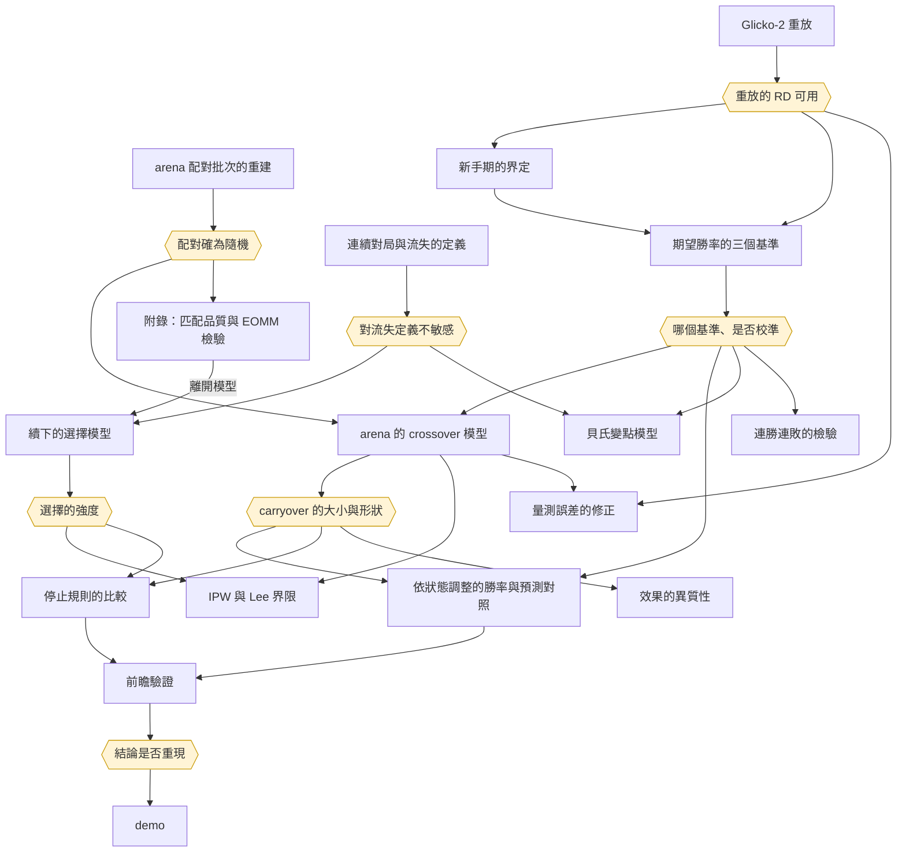

# 分析計劃

各方法要解決的問題、所依賴的前置工作與優先級。研究問題見 `docs/design.md`，文獻出處見 `docs/literature.md`。

## 借用的方法：原論文解決什麼，本研究借它解決什麼

借用時須分清兩件事：原論文用這個方法回答什麼問題、在什麼條件下成立；本研究用它回答什麼，條件是否仍成立。

### EOMM（arXiv 1702.06820）

- **原論文的問題**：「勢均力敵的配對對投入度最好」這個假設是否成立；若不成立，如何配對才能讓總流失最小
- **方法**：把等待配對的玩家視為完全圖，邊的權重是兩人配對後的流失機率之和，以 minimum weight perfect matching 求總流失最小的配對。流失機率分解為 `Pr(結果 | 雙方實力) × Pr(流失 | 自身狀態, 結果)`；後者以 logistic 迴歸估計，特徵為最近 10 局的勝和負、間隔時間與近期局數，流失定義為之後 8 小時不再下 1v1
- **關鍵假設**：給定本局結果，對手的狀態不再影響自己是否流失，即 `c(s_i, s_j, o) = c(s_i, o)`。對手只透過結果影響流失
- **理論結論**：若只有結果影響流失，且 `c(勝) + c(負) > 2c(和)`，等實力配對與 EOMM 等價；反之等實力配對反而最差。若流失只取決於自身狀態，任何配對都與隨機配對一樣
- **原論文的限制**：EA 的資料，配對由系統依實力決定，無法檢驗上述假設；策略比較只能模擬；和局機率固定為 20%，不隨分差變化
- **模擬的設定**：等待名單由真實玩家狀態的集合中抽出 P 人組成，不是真實同時在線的名單；每輪獨立，玩家的實力與狀態不隨輪更新，流失者也不離開池子；以 10,000 輪的 Welch t 檢定比較各策略。這個檢定的變異只來自模擬的抽樣，不含流失模型與實力模型的估計誤差，輪數越多越顯著；各策略留住的人數差距小。本研究的對應做法：等待名單取自真實的 arena 配對批次，流失模型以隨機配對估計並納入「結果 × 分差」，勝和負機率取自校準的有序模型，以 parametric bootstrap 傳遞兩個模型的估計誤差
- **本研究借它解決**：在 2014 年 arena 的隨機配對下直接檢驗關鍵假設：控制本局結果後，分差是否仍影響流失；以理論結論的不等式判斷等實力配對在 Lichess 上是否最好。放附錄；其離開模型是主問題續下模型的來源。配對策略的模擬不做：arena 開賽批之後多半只有兩人同時空閒，任何配法都相同
- **條件是否成立**：隨機配對使分差與玩家狀態無關，檢驗不受自選混淆。和局機率以校準後的模型取代固定值

### Heliyon 2024（Kang、Suh、Kim）

- **原論文的問題**：配對經驗與對局表現是否導致流失。假設包括：配到較弱的對手降低流失、分差的變異提高流失、勝率與連勝降低流失、連敗提高流失、遊戲階段調節上述效果
- **方法**：玩家日為單位，流失定義為之後 14 天沒有對局。雙向固定效應 logistic 迴歸（玩家、日期），回報平均半彈性；以 Hausman、Wald、概似比檢定與 BIC 選模型；依改版前後、活躍度與新舊玩家分樣本檢驗穩健性
- **原論文的限制**：觀察資料，配對由系統依分數決定，作者承認無法做隨機實驗；固定效應只處理不隨時間變的玩家差異與共同的日期衝擊，隨時間變動的混淆（如同時在線人數影響配對品質）未處理；勝率等表現變數本身是投入的結果，可能內生
- **本研究借它解決**：在 Lichess 上以同一模型分別估計大廳對局（自選對手）與 arena 對局（隨機配對），比較兩者，說明「觀察資料加固定效應」這個電競研究的常見做法與隨機配對下的估計差多少
- **條件是否成立**：大廳與 arena 的差別不只在配對是否隨機，情境也不同（錦標賽有固定時長、計分方式不同）。兩者的差距是偏誤與情境差異的合併，報告須說明，不可全歸於偏誤

### 存活分析與 mean cumulative function（arXiv 1701.02359、1709.06737）

- **原論文的問題**：玩家仍在遊戲中、尚未流失時，如何衡量留存而不因設限而偏誤
- **本研究借它解決**：描述留存的基準曲線，處理期末的右設限

### Lichess 上的連勝與贏輸效應研究（arXiv 2207.07780、2503.21713）

- **原論文的問題**：連勝連敗是否長於隨機；上一局的勝負是否影響下一局的勝率
- **原論文的限制**：前者的虛無模型打亂時間順序，忽略等級分的變化；後者只抽樣少數玩家、丟棄和局、不處理續下的選擇
- **本研究借它解決**：主問題的對照。沿用其連續對局的切分方式，改以期望得分為基準、保留和局、以 arena 的隨機對手識別上一局結果的效果、為續下建模

### crossover design 的殘留效應

- **原本的問題**：同一受試者依序接受不同處理，前一期的處理是否影響後一期的反應
- **模型**：反應 = 受試者 + period + direct effect + carryover；處理的順序隨機時，direct 與 carryover 都可識別
- **本研究借它解決**：arena 中每位玩家每局被隨機分到不同強度的對手，即多期的 crossover 實驗。前一至三局對手強弱的效果就是 carryover，也就是 tilt
- **條件是否成立**：處理（對手強弱）隨機，但期數不是固定的：下到第幾局取決於玩家是否續下，所以 period 只作描述，觀察到第 k 期的樣本經過選擇，須另外處理（見「續下的選擇模型」）

### Lee 界限

- **原本的問題**：實驗中反應只在部分受試者身上觀察得到（例如就業者才有薪資），而處理影響誰被觀察到
- **方法**：假設處理對「是否被觀察到」的影響是單調的，把觀察比例較高的一組在反應分布的上端或下端修剪掉多出的比例，得到效果的上下界
- **本研究借它解決**：上一局對手強弱影響是否續下，下一局的表現只在續下時觀察得到。界限不依賴 inverse probability weighting 的「給定控制變數，續下與表現無關」
- **條件是否成立**：單調性指「被分到較強的對手不會使任何人更願意續下」，須以資料中續下率隨對手強弱的方向支持。出處待查證後列入 `docs/literature.md`

### CUSUM 與 optional stopping

- **CUSUM 原本的問題**：生產線上偵測平均值的偏移，累積偏差越過門檻即停機檢查，以平均連串長度權衡誤報與偵測速度
- **optional stopping theorem**：martingale 在有界的停止時間上，期望值不因停止規則而改變
- **本研究借它解決**：期望勝率準確且結果無延續效果時，等級分的變化是 martingale，任何停止規則都無用，這是停止規則的虛無模型。偏離它的地方由主問題估計，CUSUM 是據此設計的停止規則。出處待查證後列入 `docs/literature.md`

## 方法清單

優先級分五級：

- **基礎**：其他方法都要用到的定義與資料重建
- **核心**：期望勝率的校準與主問題的識別、推論
- **延伸**：以核心結果為輸入，轉為預測、停止規則或 demo
- **附屬**：附屬問題
- **附錄**：已完成、不在主線但保留於附錄的分析

| 方法 | 解決的問題 | 所需的資料與前置工作 | 優先級 |
|---|---|---|---|
| 連續對局與流失的定義 | 「續下」「離開」「回訪」的操作定義 | 單一 parquet | 基礎（已完成） |
| arena 配對批次的重建 | 每次配對時同時空閒的玩家；permutation test 的打亂範圍 | 單一 parquet | 基礎（已完成） |
| Glicko-2 重放 | 每局對局前的 rating deviation | 單一 parquet、Lichess 的等級分規則 | 基礎（已完成） |
| 新手期的界定 | 新帳號的等級分不準，殘差在新手期不可照字面解讀 | 重放的 rating deviation；累計局數作敏感度分析 | 基礎 |
| 期望勝率的三個基準 | 期望勝率在哪些對局條件下錯；主問題用哪個基準 | 校準、重放、新手期 | 核心 |
| arena 的 crossover 模型 | 剛輸之後下一局是否低於期望；前一至三局的 carryover | 配對批次、基準 | 核心 |
| 續下的選擇模型 | 下一局只在續下時觀察得到 | 流失定義、API 的對局結束時間 | 核心 |
| inverse probability weighting 與 Lee 界限 | 處理續下的選擇 | 選擇模型、crossover 模型 | 核心 |
| 量測誤差的修正 | 剛輸的人等級分被低估，殘差被假性墊高 | 重放的 rating deviation、crossover 模型 | 核心 |
| 依狀態調整的勝率與預測對照 | 修正後的勝和負機率；機器學習與深度學習能改善多少 | 基準、crossover 模型 | 延伸 |
| 停止規則的比較 | 各停止規則的期望等級分變化與期望局數 | crossover 模型、選擇模型 | 延伸 |
| 前瞻驗證 | 2014 年的結論在未看過的 2015 年資料上是否重現 | 以上全部；登記文件 | 延伸 |
| demo | 把修正後的勝率與停止規則交給玩家 | 依狀態調整的勝率、停止規則 | 延伸 |
| 效果的異質性 | 效果在玩家間差多少 | crossover 模型 | 附屬 |
| 貝氏變點模型 | 第幾局之後開始低於期望（描述） | 基準、流失定義 | 附屬 |
| 連勝連敗的 parametric bootstrap 與 Markov chain 檢驗 | 連敗是否超出期望勝率的預期 | 基準 | 附屬 |
| rematch 的實測 | 輸後的 rematch 表現；樣本與選擇是否撐得起 | 基準 | 附屬，實測後決定 |
| 隨機配對下匹配品質的效果 | 分差是否影響續下與離開；也是續下模型的來源 | 流失定義、配對批次、校準 | 附錄（已完成） |
| EOMM 關鍵假設的檢驗 | 給定結果，分差是否仍影響離開 | 上一列 | 附錄（已完成） |
| Heliyon 模型的複製與比較 | 觀察資料加固定效應與隨機配對下的估計差多少 | 流失定義、新手期 | 已完成，是否入附錄未定 |
| AoE2 的外部效度 | 「剛輸之後低於期望」在排隊配對中是否同向 | 核心的結果、AoE2 資料與使用條款 | 有餘裕時 |

## 各方法的統計模型

符號：一局中玩家 $i$ 的對手為 $j$，對局前等級分為 $r_i, r_j$。Elo 形式的期望得分 $E_{ij} = 1/(1 + 10^{-(r_i - r_j)/400})$；匹配品質 $q_{ij} = |E_{ij} - 0.5|$，越小越接近勢均力敵。本局結果 $o_{ij} \in \{\text{負}, \text{和}, \text{勝}\}$。

每個方法列出：反應變數、模型、主要解釋變數、估計與推論、須檢驗的假設、實作套件。

### 連續對局與流失的定義

- **做法**：不是模型，是操作定義。看同一玩家相鄰兩局開局間隔的分布（取對數），依速度類別分開；以分布的低谷或混合分布的分界決定連續對局的切分門檻，並與 arXiv 2503.21713 的 Bullet 5 分鐘、Blitz 7 分鐘比較
- **反應變數的定義**：
  - 續下：同一連續對局內是否還有下一局（二元）
  - 短期離開：之後 8 小時內是否還有對局（二元，同 EOMM）
  - 流失：之後 14 天內是否還有對局（二元，同 Heliyon 2024）
  - 錦標賽中途離開：同一場錦標賽內是否還有下一局，且距錦標賽結束仍有足夠時間
  - 回訪時間：到下一局的時間（存活時間，期末為右設限）
- **須檢驗**：結論對門檻的敏感度，至少換兩個門檻重做主要估計
- **套件**：polars

### arena 配對批次的重建

- **做法**：同一場錦標賽中開局時間相同（到秒）的對局視為同一批配對，該批的玩家即當時同時空閒者
- **須檢驗**：
  - 若配對確為隨機，批內雙方等級分應無關：以批內打亂的 permutation test 檢驗批內相關
  - 批的大小分布是否合理（多為偶數人；剩一人時延到下一批）
  - 開局時間只到秒，不同批可能同秒；以 API 的毫秒時間在抽樣的錦標賽上核對
- **套件**：polars、numpy

### 新手期的界定

- **主定義**：重放的 rating deviation 高於 Lichess 標示 provisional 的門檻者為新手（`docs/glicko-replay.md`）；以下的累計局數界定作敏感度分析

- **反應變數**：期望得分殘差 $y_{ij} - E_{ij}$（$y$ 勝 1、和 0.5、負 0）
- **模型**：殘差的絕對值或平方對帳號累計局數做平滑迴歸（LOWESS 或 spline），找殘差不再隨局數下降的轉折點，作為新手期的資料驅動門檻
- **代理的驗證**：arena 玩家有帳號建立時間。比較「2013 年起的累計局數」與「真實帳號年齡」所界定的新手，以一致率與 Cohen's kappa 衡量代理的品質
- **須檢驗**：門檻的敏感度；2013 年初就出現的帳號標為建立時間不明，另做排除後的分析
- **套件**：statsmodels（LOWESS）、polars

### Glicko-2 重放

- **做法**：確定性的演算法，不是估計。依 Glickman 的 Glicko-2 步驟與 Lichess 所用 `org.goochjs.glicko2` 的實作，逐局更新每位玩家各速度類別的等級分、RD 與 volatility。2014 年 7 月底以前依 `RatingFest` 所用的規則，之後依線上規則
- **驗證**：重放所得的對局前等級分與表頭 `WhiteElo`、`BlackElo` 的相符比例與差距分布；依月份、速度類別、帳號年齡分層看不相符的位置
- **須檢驗**：Python 參考實作與表頭在小樣本上逐局比對；若需加速再寫 Rust 版本，並以 Python 版本驗證一致（`CLAUDE.md` 的 Rust 條款）
- **套件**：純 Python 參考實作；必要時 Rust（pyo3）

### 期望得分的校準

- **反應變數**：白方視角的結果 $Y \in \{\text{負}, \text{和}, \text{勝}\}$，有序類別
- **模型**：
  - 描述：依 $E$ 分組的實際平均得分對 $E$（校準曲線），分速度類別、等級、新手期、對局來源（arena 或大廳）
  - 主模型：cumulative logit（proportional odds）$\text{logit}\,P(Y \le k) = \theta_k - (\beta_1 d + \beta_2 \bar r + \beta_3 d \bar r)$，$d = r_W - r_B$，$\bar r$ 為雙方平均等級分。$\theta_k$ 的間距決定和局機率；先手優勢由截距位移表示
  - 對照：Davidson 型的和局模型、arXiv 2505.24783 的和局與先手隨實力變化的配對比較模型
- **檢驗的假設**：
  - Elo 形式是否校準：把斜率固定為 Elo 隱含值 $\ln 10 / 400$ 的受限模型對自由模型，概似比檢定
  - 和局機率是否隨等級上升、先手優勢是否隨等級擴大：$\bar r$ 相關項是否為 0，概似比檢定
  - proportional odds 假設：與分開兩個二元 logit 的模型比較
- **預測評估**：以時間切分（前段估計、後段評估），比較 log loss 與 ranked probability score
- **推論**：同一玩家的多局不獨立；以雙方帳號做 two-way cluster 的穩健標準誤，或以玩家為單位的 block bootstrap
- **套件**：statsmodels（`OrderedModel`）；自訂模型以 scipy 最大概似

### 期望勝率的三個基準

- **反應變數**：白方視角的勝、和、負，有序類別
- **模型**：
  - 有序 logistic：即「期望得分的校準」的主模型
  - Glicko 形式：依對手的 rating deviation 把期望得分往 0.5 收縮，和局機率沿用有序 logistic 的帶寬
  - 加入 rating deviation 的有序 logistic：分差的斜率隨雙方的 rating deviation 變化
- **比較**：有序 logistic 與加入 rating deviation 者巢狀，以概似比檢定；Glicko 形式與兩者都不巢狀，以 2014 年下半年的樣本外 log loss 比較，必要時加 Vuong 檢定
- **主從**：三者都進入後續分析；主基準在估計 crossover 模型之前決定，最遲寫進前瞻驗證的登記文件
- **套件**：statsmodels（`OrderedModel`）、scipy

### arena 的 crossover 模型

- **樣本**：2014 年 arena 的玩家局，下一局取同一場錦標賽內者；錦標賽之後在大廳的下一局作補充。Bullet 與 Blitz 為主，Classical 只作描述
- **反應變數**：下一局的勝、和、負，有序類別
- **模型**：以基準的線性預測值為 offset 的有序 logistic，加入本局對手強弱（direct）、前一至三局對手強弱（carryover）、局序（period，只作描述）。對手強弱以期望得分扣除期望匹配品質 $\bar e$ 表示，只保留隨機配對產生的部分
- **報告的效果**：
  - 簡化形式：carryover 項的係數，以批內重新配對的 permutation test 推論
  - 輸棋本身的效果：簡化形式除以「上一局對手強弱 → 輸棋」的效果，bootstrap 信賴區間；須假設上一局對手只經由結果影響下一局
  - 劑量反應：carryover 對對手強弱以 spline 表示，檢驗是否線性
  - 一律換算成「相當於讓對手幾分」
- **核對**：下一局殘差對上一局對手強弱的 OLS，以玩家為單位的 bootstrap 標準誤；leverage 與 influence 診斷局數特別多的玩家
- **前提檢查**：上一局對手強弱與玩家的等級分、本場已下局數、錦標賽剩餘時間無關（平衡檢驗）
- **可行性**：`scripts/explore/prev_opponent.py` 已實測：上一局對手強弱對輸棋的預測力強，精度足以偵測數個等級分的落差；但輸的人較少留在場內下一局
- **套件**：statsmodels、numpy

### 續下的選擇模型

- **單位**：玩家局，從對局結束起算
- **反應變數**：到下一局的時間，離散成時間區段；錦標賽結束為右設限；「再開一局」與「離開」為互斥的結局
- **模型**：離散時間 hazard，每段時間一個截距的 logistic 迴歸；解釋變數為本局結果、對手強弱、「結果 × 對手強弱」、本場已下局數、錦標賽剩餘時間、速度類別、新手期
- **描述**：Kaplan–Meier；以 probability plot 檢查 hazard 的形狀
- **另檢查**：剛輸的人是否隔較久才開下一局，間隔是否影響下一局的表現
- **前置**：對局結束時間取自 API（`data/raw/lichess-game-meta/`）
- **套件**：statsmodels

### inverse probability weighting 與 Lee 界限

- **inverse probability weighting**：權重為在錦標賽剩餘時間內開下一局的機率的倒數，由選擇模型的 hazard 累積而得；權重截斷與穩定化，報告有效樣本數。假設給定控制變數，續下與下一局的表現無關
- **Lee 界限**：依上一局對手強弱分組，把續下率較高的一組在下一局表現的分布上下端修剪掉多出的比例，得效果的上下界。對手強弱是連續的，以分位數分組
- **模擬**：設定未觀測的狀態同時影響續下與下一局表現，變動其強度，看兩種方法的結論如何改變
- **多局 carryover**：需要同場連續下更多局，選擇隨之加重；第三局之後的界限若寬到沒有資訊，如實報告
- **套件**：numpy

### 量測誤差的修正

- **問題**：對局前等級分是實力的含誤差量測。剛輸的人等級分剛降，較可能被低估，下一局的殘差被假性墊高
- **做法**：以重放的 rating deviation 作為量測誤差的大小，比較加入 rating deviation 的基準與不加者的 carryover；另依 rating deviation 高低分組估計 carryover
- **對照**：玩家實力為潛在狀態、等級分為含雜訊量測的狀態空間模型，作為另一種寫法的核對

### 依狀態調整的勝率與預測對照

- **模型**：基準加上一局結果一項的有序 logistic。只加這一項，因為只有它有隨機配對的識別
- **預測對照**：LightGBM、小型 MLP、讀取玩家近 N 局序列的 GRU，輸入只用對局前已知的資訊
- **評估**：2014 年內以時間切分調參；log loss、ranked probability score、校準曲線；機器學習的機率不校準時以 temperature 或 isotonic 校準
- **用途**：機器學習與深度學習只用於預測，不用於「該停」的結論；它們明顯勝出時，表示有序 logistic 漏掉了結構，須在報告中說明是什麼
- **套件**：statsmodels、lightgbm、jax 或 torch（擇一，實測後定）

### 停止規則的比較

- **虛無模型**：期望勝率準確且無 carryover 時，等級分變化是 martingale，任何停止規則的期望等級分變化相同
- **判準**：下一局的期望等級分變化，正比於真實的期望得分減系統的期望得分
- **Markov chain**：狀態為上一局結果與已連下局數，「離開」為吸收狀態；轉移機率取自選擇模型，各狀態的表現取自 crossover 模型
- **比較的規則**：輸一局就停、連輸兩局停、CUSUM、從不停
- **計算**：吸收鏈的基本矩陣給出各規則的期望等級分變化與期望局數；Monte Carlo 加 bootstrap 傳遞估計誤差，兩者互相核對
- **CUSUM**：累加每局的實際得分減期望得分，越過門檻即建議休息；門檻由多局 carryover 決定，誤報率與偵測速度在前瞻資料上驗證
- **套件**：numpy

### 前瞻驗證

- **樣本**：2015 年 1 月 1 日至 4 月 19 日的 arena
- **登記文件**：動用前寫定並 commit 主基準、要檢驗的量、判定規則與最小可偵測效果
- **判定規則**：方向相同，且 2014 年的點估計落在 2015 年的信賴區間內
- **檢驗的量**：簡化形式的方向與大小；依狀態調整的勝率與各預測對照的 log loss；CUSUM 的誤報率與偵測速度
- **最小可偵測效果**：依樣本量與 2014 年估得的變異數計算，以等級分表示

### demo

- **形式**：React 建置的靜態網頁，放 `demo/`；模型係數與重播用的匿名對局由 Python 腳本輸出成 JSON
- **功能**：手動輸入雙方等級分、rating deviation 與上一局結果，輸出勝和負機率與「再開一局，預期低於平常多少」；以 2015 年前瞻資料的匿名對局逐局重播模型當時的預測
- **模型**：有序 logistic；機器學習明顯勝出時才考慮並列，介面標明預測與建議的分別
- **限制**：不查詢帳號；不宣稱適用於今天的 Lichess

### 效果的異質性

- **基礎**：依速度類別與等級分區間分組估計 carryover
- **升級**：組間差異不小時，以經驗貝氏估計效果在玩家間的變異；以 EM 擬合的有限混合迴歸描述受影響與不受影響兩群的比例
- **群數**：BIC 選取，以 parametric bootstrap 的概似比檢定核對
- **限制**：混合迴歸的群由模型定義，只作描述；個別玩家的估計不呈現

### 貝氏變點模型

- **反應變數**：一段連續對局內每局的表現殘差
- **模型**：第 k 局之前與之後殘差的平均值不同，k 在局序上取離散均勻先驗，以 Gibbs 抽樣估計 k 的後驗分布
- **限制**：第 k 局之後的樣本經過續下的選擇，只作描述
- **套件**：numpy 或 pymc

### rematch 的實測

- **定義**：同一對玩家在數秒內再開一局；門檻由間隔分布決定
- **實測的事**：rematch 的局數、輸方與贏方提出的比例、rematch 中實際得分減期望得分
- **納入的條件**：樣本足以給出有用的精度，且選擇（誰提 rematch）有可行的處理方式

### 附錄：隨機配對下的匹配品質與 EOMM 檢驗

以下三節已完成，放附錄；其中離開模型是「續下的選擇模型」的來源。

#### 隨機配對下匹配品質的效果

- **樣本**：2014 年 arena 對局，每局拆成雙方各一列（玩家局）
- **反應變數**：續下、短期離開、錦標賽中途離開（二元）；回訪時間（存活時間）
- **模型**：
  - 二元結果：logistic 迴歸 $\text{logit}\,P(\text{離開}_{ij}) = \alpha_{b} + \gamma q_{ij} + \delta^\top \text{結果}_{ij} + \eta^\top x_i$，$\alpha_b$ 為配對批次的固定效應（或以批次分層的 conditional logit），$x_i$ 為自身等級分、本場已下局數、錦標賽剩餘時間、速度類別、新手期
  - 分差的方向：另以有號的 $E_{ij}$（對手較強或較弱）取代 $q_{ij}$，對應 Heliyon 2024 的假設
  - 回訪時間：Cox 比例風險模型，以配對批次分層；或離散時間 hazard（complementary log-log）
- **推論**：
  - randomization inference：在同一配對批次內依 Lichess 的配對規則重新配對，重算 $\hat\gamma$，得虛無分布。檢驗的是「對手的指派對離開完全沒有影響」這個 sharp null
  - 對照：以玩家為 cluster 的穩健標準誤
- **須檢驗**：
  - 錦標賽接近結束時離開是機械性的：以剩餘時間控制，並另做只用錦標賽前段的分析
  - 比例風險假設：Schoenfeld 殘差
- **套件**：statsmodels（`Logit`、`ConditionalLogit`、`PHReg`）、pyfixest、numpy

#### EOMM 關鍵假設的檢驗

- **反應變數**：短期離開（8 小時，同 EOMM）與續下
- **模型**：EOMM 的流失模型加上分差 $\text{logit}\,P(\text{離開}_{ij}) = f(\text{最近 10 局的勝和負、間隔時間、近期局數}) + \delta^\top \text{結果}_{ij} + \gamma q_{ij} + \lambda^\top (\text{結果}_{ij} \times q_{ij})$
- **檢驗的假設**：
  - EOMM 的關鍵假設 $H_0: \gamma = 0, \lambda = 0$（給定結果，分差不影響離開），Wald 或概似比檢定
  - EOMM 的理論判準：$\Delta = c(\text{勝}) + c(\text{負}) - 2c(\text{和})$ 的正負，$c(\cdot)$ 為各結果下的平均預測離開機率；以 delta method 或 bootstrap 求信賴區間
- **須說明的限制**：本局結果是分差與離開之間的中介變數。分差是隨機指派的，但結果還受玩家當天狀態影響，而當天狀態也影響離開；控制結果後估得的 $\gamma$ 是 controlled direct effect，須假設給定已控制的變數後，結果與離開之間沒有未觀測的共同原因。以敏感度分析報告此假設不成立時結論改變的程度
- **套件**：statsmodels、numpy

#### 描述性的留存曲線

- **做法**：回訪時間的 Kaplan–Meier 曲線（依速度類別、新手期、arena 或大廳分層）；每位玩家累計局數的 mean cumulative function
- **右設限**：資料終點 2015 年 6 月底
- **套件**：statsmodels（`SurvfuncRight`）

#### Heliyon 模型的複製與比較

- **單位**：玩家日
- **反應變數**：流失（之後 14 天內沒有對局）
- **解釋變數**：當日平均有號分差（對手減自己）、分差的標準差、勝率、連勝率、連敗率（連續 3 局以上起算）、遊戲階段（帳號年齡分段）及其交互作用；控制當日局數
- **模型**：
  - Heliyon 的設定：玩家與日期的雙向固定效應 logistic 迴歸，回報平均半彈性 $\hat\beta(1 - \bar y)$
  - 玩家固定效應的 logit 有 incidental parameters 問題，以玩家為條件的 conditional logit（日期以虛擬變數）為主要估計；線性機率模型加雙向固定效應作穩健性
  - Hausman 檢定比較固定效應與隨機效應
- **比較**：同一模型分別估計大廳樣本與 arena 樣本，比較分差相關係數；兩者差距的信賴區間以玩家 block bootstrap 求得
- **須說明**：兩樣本的差距包含情境差異，不全是觀察資料的偏誤
- **套件**：pyfixest（`feols`、`feglm`）、statsmodels（`ConditionalLogit`）

### 連勝連敗的 parametric bootstrap

- **做法**：對每位玩家的實際對局序列，依校準模型給出的每局勝和負機率模擬結果，重複多次，得每位玩家連勝與連敗長度的虛無分布
- **檢定統計量**：長度至少 $k$ 的連勝與連敗次數；實際值在虛無分布中的位置
- **對照**：arXiv 2207.07780 打亂時間順序的虛無模型，比較兩種虛無模型的結論差異
- **Markov chain 檢驗**：扣除期望後，勝和負序列是否仍有一階相依：比較一階 Markov chain 與獨立模型的轉移機率，以模擬的虛無分布推論
- **套件**：numpy

### AoE2 的外部效度

- **時機**：有餘裕時才做

- **模型**：上一局結果對下一局表現殘差的模型，不做隨機化推論
- **須說明**：分差由系統依等級分決定，只能作相關的比對

### 共通事項

- **多重比較**：分層與多個反應變數的檢定，以 Holm 法控制族錯誤率，主要假設事先指定
- **時間切分**：凡需預測評估者，以時間先後切分，不隨機切分，避免以未來資訊預測過去

## 方法的升級規則

每一步先用基礎方法，通過診斷即停，不通過才升級。規則在分析之前寫定，避免看了結果再選方法。

| 環節 | 基礎方法 | 診斷 | 不通過時升級到 |
|---|---|---|---|
| 標準誤 | 以玩家為單位的 bootstrap | 與 sandwich 標準誤相差不大 | 兩者並報 |
| 基準的比較 | 概似比檢定 | 兩模型巢狀 | 樣本外 log loss，必要時 Vuong 檢定 |
| 主問題的效果 | 有序 logistic 加 permutation test | 殘差、leverage 與 influence 診斷 | 以玩家為單位的 bootstrap，並報告影響大的玩家群 |
| 續下的選擇 | 只用有下一局的樣本 | 續下率與上一局對手強弱無關 | hazard 模型加 inverse probability weighting，再加 Lee 界限 |
| 效果的異質性 | 依速度類別、等級分區間分組 | 組間差異小 | 經驗貝氏、有限混合迴歸 |

續下的選擇一列，實測已知診斷不會通過（輸的人較少留在場內），所以 inverse probability weighting 與 Lee 界限一定會用到。

## 模型比較與效果大小

- **概似比檢定**：檢驗事先指定的一項是否為 0
- **樣本外 log loss**：選擇預測用的模型
- **BIC**：只用於有限混合迴歸的群數，並以 parametric bootstrap 的概似比檢定核對；群數的檢定落在參數空間的邊界，卡方近似不成立
- **AIC**：不用
- **效果大小**：本資料樣本大，概似比檢定對幾乎任何一項都會拒絕。每個效果都換算成「相當於讓對手幾分」並附信賴區間，顯著與否只作附帶

## 結論之間的依賴

上表的「所需的資料與前置工作」是工作流程上的先後。這一節談的是推論上的依賴：一個方法的結論，決定另一個方法能否做、該怎麼做、結果如何解讀。每個結論都有成立與不成立兩種走向，計劃須兩邊都備妥。

### 會影響其他方法的結論

| 結論 | 由哪個方法得出 | 影響的方法 |
|---|---|---|
| 配對確為隨機：批內雙方等級分無關 | arena 配對批次的重建 | crossover 模型、Lee 界限、附錄的匹配品質效果與 EOMM 檢驗 |
| 期望勝率是否校準、哪個基準最好 | 期望勝率的三個基準 | 幾乎所有方法：表現的基準、勝和負機率、連勝的虛無模型 |
| 重放的 rating deviation 可用 | Glicko-2 重放 | 新手期、三個基準、量測誤差的修正 |
| 結論對流失定義的門檻是否敏感 | 連續對局與流失的定義 | 選擇模型、變點模型 |
| carryover 是否不為 0、是否隨對手強弱線性變化 | crossover 模型 | 依狀態調整的勝率、停止規則看「輸」或「爆冷輸」、CUSUM 的門檻 |
| 續下的選擇有多強 | 選擇模型 | inverse probability weighting 的權重、Lee 界限的寬度、多局 carryover 能做到幾局 |
| 量測誤差是否改變 carryover | 量測誤差的修正 | carryover 的解讀 |
| 2014 年的結論是否重現 | 前瞻驗證 | 停止規則與 demo 能否作為建議 |

### 各方法在結論成立與不成立時的走向

| 方法 | 依賴的結論 | 成立時 | 不成立時 |
|---|---|---|---|
| crossover 模型 | 配對確為隨機 | 兩局以上的批以 permutation test 推論 | 一局一批以「下完的時間與等級分無關」為前提，與隨機化推論分開陳述 |
| | 三個基準的結論一致 | 報告主基準，另兩者為敏感度分析 | 如實寫出結論依賴基準 |
| 依狀態調整的勝率 | carryover 不為 0 | 加入上一局結果一項 | 修正後的勝率即基準本身；demo 只給基準的勝率 |
| 停止規則的比較 | carryover 不為 0 | 比較各規則的期望等級分變化 | 各規則的差異只來自期望勝率的錯估；建議為「輸了不必停」 |
| | carryover 隨對手強弱線性 | 規則看輸贏 | 規則只看爆冷輸 |
| inverse probability weighting | 選擇模型的預測力足夠 | 主分析 | 權重不可信，以 Lee 界限為主 |
| 多局 carryover | 選擇不強到使界限失去資訊 | 報告前一至三局 | 只報告到界限仍有資訊的局數 |
| CUSUM | 前瞻驗證的誤報率可接受 | 作為建議 | 只作方法展示，建議以簡單規則為主 |
| 連勝連敗的 bootstrap | 期望勝率校準 | 以校準後的機率模擬 | 修正後仍不校準時，連勝的「異常」可能只是基準失準，結論不採 |
| 效果的異質性 | 組間差異小 | 只報告分組結果 | 經驗貝氏與混合迴歸 |
| AoE2 的外部效度 | 主問題的 carryover 不為 0 | 檢驗排隊配對中是否同向 | 只作描述 |

### 已得出的結論

| 結論 | 結果 | 所走的路 | 依據 |
|---|---|---|---|
| 期望得分校準 | 不成立：Elo 形式系統性高估強方優勢，老手也一樣；白方有固定優勢；和局機率隨等級上升 | 匹配品質 $q$、勝和負機率、連勝的虛無模型、表現的基準一律改用有序模型的校準期望得分；新手對局排除或讓斜率依累計局數變化。偏差的來源推測為等級分逐局波動造成的 regression dilution，Glicko-2 重放的地位因此由敏感度分析提升為解釋偏差的必要工作，但不阻擋主分析 | `docs/calibration.md` |
| 配對確為隨機 | 成立，但結構與預期不同：錦標賽第一批之後，絕大多數批次只有兩人同時空閒、只能配成一局，批內沒有可打亂的配法；空閒超過 12 人幾乎只發生在第一批 | randomization inference 只用兩局以上的批次（設計上的隨機）；12 人以下的批以「不含重複對手的配法中均勻抽出」為精確虛無分布；一局一批的配對以「下完的時間與等級分無關」為前提作模型化分析，與隨機化推論分開陳述。退路「只用空閒超過 12 人的批次」不可行 | `docs/random-pairing.md` |
| 對流失定義不敏感 | 大致成立：門檻改變續下率的高低，但除了和局相對於勝負的位置外，描述結論的方向不變 | 以主門檻為主定義，另以主門檻的一半與兩倍重做主要估計；8 小時與 14 天的定義不依賴門檻，直接並列；涉及和局的結論須報告各門檻 | `docs/sessions.md` |
| 新手期的門檻 | 暫定：以 2013 年起同一速度類別的累計局數為代理，雙方皆達門檻者為老手；校準斜率要到更多局後才完全穩定 | 主定義改為重放的 rating deviation，累計局數作敏感度分析 | `docs/calibration.md` |

| 匹配品質的總效果 $\gamma$ | 不為 0：隨機配對下，配對越懸殊，短時間窗內的離開越少，兩層識別一致。須以期望匹配品質 $\bar q$ 校正：等級分在候選者中越極端，$q$ 不論配到誰都偏大。效果有一大部分來自懸殊的對局下得較短，時間窗越短效果越大；8 小時離開的效果小，只用純隨機的批時不顯著 | 續下模型改以從對局結束起算的 hazard 模型為主，避免對局長度的機械效果；「越懸殊越少離開」不可解讀為玩家偏好懸殊的配對 | `docs/match-quality-leave.md` |
| 給定結果的直接效果與勝和負不等式 | 關鍵假設不成立：給定本局結果，分差仍影響離開（贏棋後越懸殊越少離開；爆冷輸後離開最多）。$c(\text{勝}) + c(\text{負}) - 2c(\text{和})$ 為正，但假設既不成立，不能推出等實力配對最佳 | 放附錄；主問題的續下模型同樣納入分差與「結果 × 分差」 | `docs/eomm-assumption.md` |
| Heliyon 模型的比較 | 可複製且多數方向可解讀；arena 的分差係數大於大廳，差距的信賴區間不含 0。但大廳的估計對控制自身等級分敏感，控制後直接效果變號，玩家固定效應處理不了等級分起落的混淆；每位玩家的觀察日數少，固定效應 logit 的 incidental parameters 偏誤明顯，效果大小以 conditional logit 或線性機率模型為準 | 「觀察資料加固定效應」在自選對手的情境下不可靠，這是本研究對電競文獻的方法論結論之一；14 天流失的玩家日模型與逐局的隨機配對分析，反應變數、單位與樣本都不同，不能互相驗證 | `docs/fixed-effects-churn.md` |

| 重放重現表頭 | 成立，但須以表頭校正：資料始於 2013 年，此前的 rated 對局不在資料中，從 1500 起的純重放大多不相符；改為每局與表頭取交集、不相容時以表頭重設後，Bullet、Blitz、Classical 絕大多數相符。RD 與 volatility 完全照 lila 的規則重放，以重放的 RD 預測表頭的 RatingDiff 幾乎完全相同 | 重放的 RD 可用於 Glicko-2 形式的期望得分與 provisional 定義的新手期；不相符集中於左截斷帳號的前段、2014 年 pool 試行期的 Bullet 與 Blitz、線上期間的 Classical 與通信棋，這些範圍內的 RD 須謹慎使用 | `docs/glicko-replay.md` |

| 速度類別的修正 | 結論不變：月檔的時間類別是匯出時事後標記的，2015 年 4 月下旬以前部分有加秒的大廳對局被標到慢一級的類別；arena 對局不受影響。各分析改依重放判定的速度類別（`speed`）重跑，主要結論皆未改變 | 後續分析一律依 `speed` 分組；`time_class` 只留作對照 | `docs/speed-class.md` |

這些結論帶出的待查事項：

- **2014 年 11 月底起，一局一批的重複對手驟降為零**：此前大型錦標賽也有重複對手，與原始碼的規則不符；`PairingSystem.scala` 在這段期間沒有修改，可能與錦標賽後端改寫的上線時間有關。若屬實，2014 年的配對機制以 11 月底為界分兩段，須分段檢驗
- **一局一批中執子顏色的輕微偏向**：白方等級分較高的比例略高於一半，原始碼看不出原因，可能與被中止的對局不在資料中有關
- **對局長度的機械效果與總效果的分離**：目前只有每場錦標賽第一局的對局長度（API 的 `createdAt` 與 `lastMoveAt`）。要在所有隨機配對的批次上分開機械效果，須逐局向 API 取得
- **大廳對局仍含指定邀戰與疑似 pool 的對局**：校準與流失定義的「一般對局」都未區分，須以 API 的 `source` 分開後重估

### 依賴圖

方框為方法，六角形為會影響其他方法的結論。

## 進度與待辦

### 已定的原則

- **主問題已定**：期望勝率在哪些情況下錯，與玩家的停止規則（`docs/design.md`）。候選題目與比較見 `docs/topic-options.md`
- **方法以基礎形式為先**：分析者修過的方法見 `~/vault/note`（迴歸、數理統計、多變量、貝氏、可靠度、時間序列、機率模式、統計計算）。基礎方法通過診斷即不升級（「方法的升級規則」）。randomization inference 以 permutation test 陳述；conditional logit 與固定效應 logit 以「每組有自己截距的 logistic 迴歸」陳述
- **機器學習與深度學習只用於預測**：不用於因果的結論與停止建議
- **前瞻驗證樣本只用一次**：動用前寫定登記文件
- **帳號以整數代碼分組與串接**：`lichess_games.parquet` 的 `white_id`、`black_id` 與 `player_games.parquet` 的 `player`、`opponent` 是同一套代碼。以帳號字串分組是先前記憶體不足的主因；帳號名稱只在與 API 資料串接時使用
- **一次只跑一個分析**：一個分析能用滿硬體時依序執行，以 `systemd-run --user --scope -p MemoryMax=20G -p MemorySwapMax=0` 加上執行緒數的環境變數限制。熱點先向量化，再考慮 numba，最後才寫 Rust（rayon、faer、fearless_simd、native 編譯；保留 Python 參考實作）

### 已完成

| 分析 | 文件 |
|---|---|
| 期望得分的校準（有序 logistic 對 Elo 形式） | `docs/calibration.md` |
| arena 配對的隨機性 | `docs/random-pairing.md` |
| 連續對局與流失的定義 | `docs/sessions.md` |
| 隨機配對下匹配品質的效果 | `docs/match-quality-leave.md` |
| EOMM 關鍵假設的檢驗 | `docs/eomm-assumption.md` |
| Heliyon 模型的複製與比較 | `docs/fixed-effects-churn.md` |
| Glicko-2 重放 | `docs/glicko-replay.md` |
| 速度類別的修正 | `docs/speed-class.md` |

### 進行中

- **2014 年對局的配對來源與對局時間**：`scripts/fetch/lichess_game_meta.py` 以 systemd unit `lichess-game-meta` 在背景執行，arena 對局先、大廳對局後，可續傳，網路錯誤自動重試，行程失敗時 systemd 自動重啟。進度見 `data/raw/lichess-game-meta/fetch.log`。速率由伺服器限制，帶 token 也不會加快。完成後須補寫 `data/raw/lichess-game-meta/SOURCE.md`

### 待辦（依序）

1. **新手期以 rating deviation 界定**：門檻取 Lichess 標示 provisional 的值；累計局數作敏感度分析
2. **期望勝率的三個基準**：只用 2014 年；比較完後決定主基準，在估計 crossover 模型之前寫定
3. **arena 的 crossover 模型**：簡化形式、前一至三局的 carryover、劑量反應、平衡檢驗
4. **續下的選擇模型**：待 arena 的對局結束時間取得
5. **inverse probability weighting、Lee 界限與模擬**
6. **量測誤差的修正**
7. **依狀態調整的勝率與預測對照**
8. **停止規則的比較**：Markov chain、CUSUM
9. **附屬**：連勝連敗的檢驗、貝氏變點模型、效果的異質性、rematch 的實測
10. **前瞻驗證的登記文件**，之後才動用 2015 年 1 月 1 日至 4 月 19 日的 arena
11. **demo**
12. **附錄**：以對局結束起算的 hazard 模型扣除匹配品質效果中的對局長度機械效果
13. **有餘裕時**：AoE2 的外部效度

## 執行上的判斷

- **先做會左右最多方法的結論**：基準與配對是否隨機影響幾乎所有方法；配對的隨機性已確認，基準剩三者的比較
- **carryover 是樞紐**：依狀態調整的勝率、停止規則、CUSUM 的門檻都依賴它的大小與形狀
- **選擇偏誤是評分時會被重點檢視的一環**：inverse probability weighting 的假設無法檢驗，Lee 界限與模擬必須一起報告
- **輸棋本身的效果多一個假設**：上一局對手只經由結果影響下一局。附錄的 EOMM 檢驗發現對手經由結果以外的途徑影響離開，這個假設同樣可能不成立，所以簡化形式為主、比值為解讀
- **前瞻驗證之前不得反覆修改模型**：2014 年內可反覆，登記之後只跑一次
