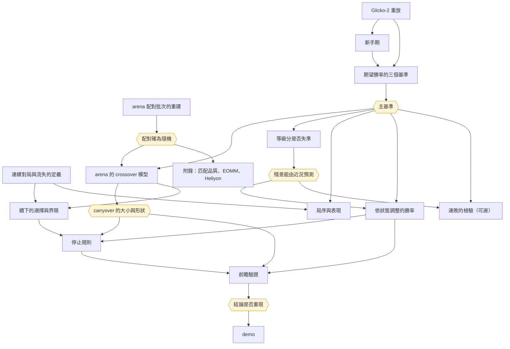

# 分析計劃

依研究問題排列的方法、各方法的定位、結論之間的依賴、進度與待辦。研究問題見 `docs/design.md`；各方法的模型、假設與統計依據見 `docs/methods.md`。

## 框架

- **推論的依據**：主問題的因果推論只依賴 2014 年 arena 已知的隨機配對機制，以批內 permutation test 推論；模型只用來提高精度與換算效果的大小
- **檢定的優先序**：概似比檢定優先，其次 score 檢定，最後 Wald 檢定；資料有玩家與 dyadic 相依時用修正版。信賴區間可用 delta method（`docs/methods.md`「檢定與區間」）
- **方法的定位**：每個方法屬主要做法、對照、退路之一，在分析之前寫定，不看結果再挑方法
- **基礎方法優先**：有更簡單而同樣嚴謹的做法時不用複雜模型；選對照時優先用修課教過的模型
- **範圍以交付物為準**：交付物是修正後的勝和負機率與停止規則。撐起這兩者與主結論的分析做完整；只多一層對照或延伸的不做
- **停止的決策與因果的解讀分開**：修正後的勝率與停止規則只需要預測力，以時間切分的樣本外表現與回測評估；「剛被分到強對手使下一局變差」這個因果解讀只依據隨機配對。剛輸之後的偏差來自 tilt 還是等級分調得不夠，本資料分不開，不再追究，報告寫成限制
- **前瞻驗證只用一次**：2015 年 1 月 1 日至 4 月 19 日的 arena，動用前寫定並 commit 登記文件

## 研究問題與方法

### 地基：資料與定義

| 項目 | 回答 | 狀態 | 文件 |
|---|---|---|---|
| 連續對局與流失的定義 | 續下、離開、回訪的操作定義 | 已完成 | `docs/sessions.md` |
| arena 配對批次的重建 | 每次配對時同時空閒的玩家；permutation test 的打亂範圍 | 已完成 | `docs/random-pairing.md` |
| Glicko-2 重放 | 每局對局前的 rating deviation | 已完成 | `docs/glicko-replay.md` |
| 速度類別 | 等級分屬於哪一個類別 | 已完成 | `docs/speed-class.md` |
| 新手期 | 等級分尚未收斂的對局如何界定 | 已完成 | `docs/novice-period.md` |
| 配對來源 | API 的 `source` | 抓取中 | `data/raw/lichess-game-meta/` |

### 期望勝率是否校準（已完成）

| 定位 | 方法 |
|---|---|
| 主要做法 | 三個基準（有序 logistic、Glicko 形式、加入 rating deviation 的有序 logistic）巢狀於第三者，以修正的概似比檢定比較 |
| 對照 | 樣本外對數分數與 ranked probability score |

- **輸出**：主基準為加入 RD 的有序 logistic；Elo 形式哪裡偏（`docs/calibration.md`、`docs/expected-score-baselines.md`）

### 剛被分到強對手之後，期望勝率是否又錯一層（已完成）

| 定位 | 方法 |
|---|---|
| 主要做法 | 總效果：上一局所屬批內重新配對的 permutation test |
| 主要做法 | 直接效果：基準變數自由估計的有序 logistic，殘差做玩家內對比，配對 $t$ 檢定 |
| 主要做法 | 輸棋本身的效果（平均得分差的比值）；勝負兩邊的對稱性；劑量反應 |
| 對照 | 玩家斜率的 $t$ 檢定；以局加權的修正概似比檢定與玩家 bootstrap；只用純隨機規則的批；CMH 與 Mantel–Haenszel |

- **輸出**：`docs/crossover.md`

### 續下的選擇（已完成）

| 定位 | 方法 |
|---|---|
| 主要做法 | 續下的 logistic 迴歸；單調性的檢查；Lee 界限 |
| 對照 | 不假設單調性的界限；inverse probability weighting；選擇上的有參數敏感度分析 |

- **輸出**：`docs/continuation.md`

### 等級分在剛輸之後是否失準（已完成）

| 定位 | 方法 |
|---|---|
| 主要做法 | 依 RD 與上一局結果分層的 Cox 校準檢定；校準迴歸中加入上一局等級分變動的概似比檢定，與它隨 RD 變化的交互作用檢定 |
| 描述 | 依 RD 與上一局結果分層的校準曲線 |

- **輸出**：`docs/rating-filter.md`。RD 的五等分幾乎沒有 RD 的差異，照事先的切法報告，不改切法重跑

### 局序與表現

| 定位 | 方法 |
|---|---|
| 描述 | pattern-mixture：依連續對局的最終長度分組，看組內各局的平均殘差 |

- **用途**：回答「下到第幾局之後開始低於期望」；作為停止規則的背景，不觸發其他方法
- **前置**：主基準；連續對局的定義

### 依狀態調整的勝率（預測交付物）

| 定位 | 方法 |
|---|---|
| 主要做法 | 主基準加上一局結果與上一局等級分變動的有序 logistic；各項是否加入由樣本外對數分數決定，不由 crossover 是否顯著決定 |
| 對照 | LightGBM，只作預測上限的參照 |

- **前置**：主基準；等級分是否失準
- **評估**：2014 年依時間分成估計與評估兩段；對數分數、ranked probability score、校準曲線
- **輸出**：修正後的勝、和、負機率，與「再開一局，預期比系統的期望低多少」

### 停止規則（建議交付物）

| 定位 | 方法 |
|---|---|
| 主要做法 | 回測：事先寫定的規則（一路下到第一次輸、爆冷輸才停、連輸兩局才停、預測的下一局殘差小於 0 即停）套到實際序列，比較保留與刪去的局的平均殘差，以「從不停」為基準；玩家 block bootstrap，多條規則以 Holm 法校正 |
| 主要做法 | 隔天重置：刪去的局與隔天第一局的殘差比較；後者不比前者好時，停下只是把虧分延後 |

- **前置**：依狀態調整的勝率（最後一條規則由它得出）；續下的選擇（回測只刪局，針對的是續下者）
- **輸出**：民間規則有沒有用；依速度類別與新手與否的停止規則

### 前瞻驗證

- **登記文件**：主基準、檢驗的量、判定規則、檢定水準與方向、最小可偵測效果與檢定力
- **檢驗的量**：Blitz 剛被分到強對手之後的總效果；依狀態調整的勝率的樣本外對數分數；停止規則回測中勝過「從不停」的規則
- **判定規則**：2015 年的總效果以單尾檢定拒絕「效果不在 2014 年的方向」，且兩年的效果以同質性檢定不拒絕，並報告兩年差值的信賴區間
- **一併登記的事後型態**：上一局等級分變動的係數為正；剛贏之後好於期望；高 RD 剛輸之後差於期望。這三項是看過 2014 年結果後才形成的，只在 2015 年的樣本上檢驗方向

### demo

- 手動輸入雙方等級分、rating deviation 與上一局結果，輸出修正後的勝、和、負機率與「再開一局，預期低於平常多少」
- 只在前瞻驗證通過後，把停止規則作為建議呈現

### 可選：連勝連敗是否超出期望

回應電競玩家「系統故意製造連敗」的指控，為主題新穎的加分項；時間不夠時不做。

- **做法**：依主基準機率的 parametric bootstrap，停止時點以續下模型一併模擬；只用一個事先指定的 $k$，統計量為長度至少 $k$ 的連勝與連敗次數
- **解讀的前提**：等級分調得不夠本身就會使連勝連敗多於期望（`docs/rating-filter.md`），報告須先寫明這個不需要任何操控的解釋

### 附錄

| 分析 | 狀態 |
|---|---|
| 隨機配對下匹配品質的效果 | 已完成（`docs/match-quality-leave.md`） |
| EOMM 關鍵假設的檢驗 | 已完成（`docs/eomm-assumption.md`） |
| Heliyon 模型的複製與比較 | 已完成（`docs/fixed-effects-churn.md`），頁數不足時只放一段 |

### 不做的分析

| 分析 | 理由 |
|---|---|
| crossover 的其餘對照：玩家隨機截距的 GLMM、Bradley–Terry–Davidson 模型、錦標賽之後大廳的下一局 | 已有多種對照且結論一致；再加一個不改變結論 |
| 固定長度組內的貝氏變點模型、risk-adjusted CUSUM | Blitz 的 carryover 只延續一局，持續偏移的前提不成立 |
| Markov chain 上以動態規劃求最適停止規則 | 「預測的下一局殘差小於 0 即停」直接由預測模型得出，即 one-stage look-ahead 規則 |
| GAM、校準樣本上的重新校準 | 預測模型的變數由樣本外表現決定；LightGBM 已給出預測上限 |
| 第一局作為探測 | 不影響停止規則的建議 |
| Romano–Wolf 的逐步檢定與 SPA 檢定 | 規則只有少數幾條，以 Holm 法校正即可 |
| 效果異質性的隨機斜率 GLMM | 依速度類別分組已回答誰受影響 |
| 輸後的 rematch | 與交付物無關 |
| 競爭風險 hazard、對局長度的機械效果 | 只服務附錄，且須逐局取得 API 的對局時間 |
| 2014 年 pool 的可行性檢查、AoE2 的外部效度 | 延伸，不在交付物內 |
| 區分 tilt 與濾波誤差 | 交付物只需要預測力；RD 的變化不足以區分，寫成限制 |

## 結論之間的依賴

### 會影響其他方法的結論

| 結論 | 由哪個方法得出 | 影響的方法 |
|---|---|---|
| 配對確為隨機 | 配對批次的重建 | crossover 模型、續下的選擇、附錄 |
| 主基準 | 三個基準 | 幾乎所有方法：表現的基準、勝和負機率、連敗的虛無模型 |
| carryover 的大小與形狀 | crossover 模型 | 停止規則中「爆冷輸才停」的門檻；前瞻驗證的檢驗量 |
| 殘差能由近況預測 | 等級分是否失準 | 依狀態調整的勝率的候選變數；連勝連敗的解讀 |
| 2014 年的結論是否重現 | 前瞻驗證 | 停止規則與 demo 能否作為建議 |

### 各方法在結論成立與不成立時的走向

| 方法 | 依賴的結論 | 成立時 | 不成立時 |
|---|---|---|---|
| 依狀態調整的勝率 | 加入近況的項改善樣本外對數分數 | 加入該項 | 修正後的勝率即主基準本身；demo 只給主基準的勝率 |
| 停止規則 | 某條規則在回測中勝過從不停 | 檢查隔天重置；不比隔天第一局差才作為建議 | 建議為「依系統的勝率下，輸了不必停」 |
| demo 的建議 | 前瞻驗證通過 | 呈現停止規則 | 只呈現勝和負機率，註明未通過驗證 |
| 連敗的 bootstrap | 主基準校準 | 以主基準的機率模擬 | 連敗的「異常」可能只是基準失準，結論不採 |

### 已得出的結論

| 結論 | 結果 | 所走的路 | 依據 |
|---|---|---|---|
| 期望得分校準 | 不成立：Elo 形式系統性高估強方優勢，老手也一樣；白方有固定優勢；和局機率隨等級上升 | 匹配品質 $q$、勝和負機率、連勝的虛無模型、表現的基準一律改用有序模型的校準期望得分；新手對局排除或讓斜率依累計局數變化。偏差的來源待分解：等級分是 Glicko 濾波器的事後平均，量測誤差屬 Berkson 型，不會使斜率衰減，所以候選來源是濾波器的設定讓等級分過度反應；Glicko-2 重放因此是解釋偏差的必要工作，但不阻擋主分析 | `docs/calibration.md` |
| 配對確為隨機 | 成立，但結構與預期不同：錦標賽第一批之後，絕大多數批次只有兩人同時空閒、只能配成一局，批內沒有可打亂的配法；空閒超過 12 人幾乎只發生在第一批 | randomization inference 只用兩局以上的批次（設計上的隨機）；12 人以下的批以「不含重複對手的配法中均勻抽出」為精確虛無分布；一局一批的配對以「下完的時間與等級分無關」為前提作模型化分析，與隨機化推論分開陳述。退路「只用空閒超過 12 人的批次」不可行 | `docs/random-pairing.md` |
| 對流失定義不敏感 | 大致成立：門檻改變續下率的高低，但除了和局相對於勝負的位置外，描述結論的方向不變 | 以主門檻為主定義，另以主門檻的一半與兩倍重做主要估計；8 小時與 14 天的定義不依賴門檻，直接並列；涉及和局的結論須報告各門檻 | `docs/sessions.md` |
| 新手期的門檻 | 主定義為任一方重放 RD ≥ 110（Lichess 自 2015 年 6 月起標示 provisional 的門檻；2014 年的程式碼沒有這個概念）。RD 門檻約略等於固定的局數，與累計局數的代理高度一致；但校準斜率在 110 處沒有斷點，隨 RD 下降連續上升，到更低的 RD 才趨穩，門檻是約定而非資料的轉折點 | 新手的偏差以加入 RD 的基準吸收，門檻只用於描述與限樣本的敏感度分析；敏感度取 RD ≥ 100 與雙方累計局數皆至少 30 局。arena 的新手對局占比高於 lobby，處理新手對主問題較重要 | `docs/novice-period.md` |
| 匹配品質的總效果 $\gamma$ | 不為 0：隨機配對下，配對越懸殊，短時間窗內的離開越少，兩層識別一致。須以期望匹配品質 $\bar q$ 校正：等級分在候選者中越極端，$q$ 不論配到誰都偏大。效果有一大部分來自懸殊的對局下得較短，時間窗越短效果越大；8 小時離開的效果小，只用純隨機的批時不顯著 | 續下改以「本場內是否再開一局」的二元結果為主，只取距結束仍有足夠時間的局，不受時間窗與對局長度影響；hazard 只作描述與附錄的機械效果分解；「越懸殊越少離開」不可解讀為玩家偏好懸殊的配對 | `docs/match-quality-leave.md` |
| 給定結果的直接效果與勝和負不等式 | 關鍵假設不成立：給定本局結果，分差仍影響離開（贏棋後越懸殊越少離開；爆冷輸後離開最多）。$c(\text{勝}) + c(\text{負}) - 2c(\text{和})$ 為正，但假設既不成立，不能推出等實力配對最佳 | 放附錄；主問題的續下模型同樣納入分差與「結果 × 分差」 | `docs/eomm-assumption.md` |
| Heliyon 模型的比較 | 可複製且多數方向可解讀；arena 的分差係數大於大廳，差距的信賴區間不含 0。但大廳的估計對控制自身等級分敏感，控制後直接效果變號，玩家固定效應處理不了等級分起落的混淆；每位玩家的觀察日數少，固定效應 logit 的 incidental parameters 偏誤明顯，效果大小以 conditional logit 為準 | 「觀察資料加固定效應」在自選對手的情境下不可靠，這是本研究對電競文獻的方法論結論之一；14 天流失的玩家日模型與逐局的隨機配對分析，反應變數、單位與樣本都不同，不能互相驗證 | `docs/fixed-effects-churn.md` |
| 重放重現表頭 | 成立，但須以表頭校正：資料始於 2013 年，此前的 rated 對局不在資料中，從 1500 起的純重放大多不相符；改為每局與表頭取交集、不相容時以表頭重設後，Bullet、Blitz、Classical 絕大多數相符。RD 與 volatility 完全照 lila 的規則重放，以重放的 RD 預測表頭的 RatingDiff 幾乎完全相同 | 重放的 RD 可用於 Glicko-2 形式的期望得分與 provisional 定義的新手期；不相符集中於左截斷帳號的前段、2014 年 pool 試行期的 Bullet 與 Blitz、線上期間的 Classical 與通信棋，這些範圍內的 RD 須謹慎使用 | `docs/glicko-replay.md` |
| 速度類別的修正 | 結論不變：月檔的時間類別是匯出時事後標記的，2015 年 4 月下旬以前部分有加秒的大廳對局被標到慢一級的類別；arena 對局不受影響。各分析改依重放判定的速度類別（`speed`）重跑，主要結論皆未改變 | 後續分析一律依 `speed` 分組；`time_class` 只留作對照 | `docs/speed-class.md` |
| 修正的概似比檢定的檢定水準 | 有效玩家數到數千時接近名目水準；有效玩家數少時仍偏寬鬆。Blitz、Classical 的真實樣本落在接近名目水準的範圍，Bullet 略為寬鬆 | 修正的概似比檢定作為主要做法；Bullet 上接近顯著邊緣的結果須保留，必要時改用小樣本修正的 sandwich | `docs/expected-score-baselines.md` |
| 改用修正的概似比檢定後的結論 | 校準、EOMM 關鍵假設、Heliyon 的階段與 Mundlak 檢定的結論皆未改變；獨立假設下的 p 值普遍過小 | 已得出的結論照舊；`scripts/speed_fix_effect.py` 的修正前後比較仍以 Wald 為準，不重跑 | `docs/calibration.md`、`docs/eomm-assumption.md`、`docs/fixed-effects-churn.md` |
| 期望勝率的三個基準 | 有序 logistic 與 Glicko 形式對加入 RD 的有序 logistic 都被拒絕；加入 RD 的模型在全部、新手、老手三組的樣本外表現都最好；RD 的收縮比 Glicko 的式子更強 | 主基準定為加入 RD 的有序 logistic，另兩者作敏感度分析；新手對局留在主樣本，由基準吸收 | `docs/expected-score-baselines.md` |
| 剛被分到強對手之後的 carryover | Bullet 沒有證據；Blitz 的總效果成立、只延續一局，直接效果的主要檢定方向相同但不顯著，連續 $h$ 的對照顯著。上一局的配對會改變下一局的對手，總效果含這條 arena 特有的管道 | 依狀態調整的勝率只在 Blitz 加入上一局一項；類推到排隊配對時只能說直接效果方向一致、未能確立；結論只在續下者上成立（見下一列） | `docs/crossover.md` |
| 續下的選擇 | 被分到強對手的人較少續下，續下率隨對手變強單調下降，升級規則的診斷不通過；給定本局結果時方向反轉，輸給強對手比輸給弱對手較常續下。Lee 界限在所有速度類別、層與局數都含 0，不假設單調性的界限寬到沒有資訊；只要「因對手弱才多留下來的人」下一局表現稍好，Blitz 的點估計就變號 | Blitz 的 carryover 只在續下者上成立，對兩種對手強弱下都會續下的玩家未能確立，多局 carryover 也只在續下者上報告。預測與停止規則的回測針對的本來就是續下者，不受影響；停止規則的建議不說「輸棋使人變差」。連敗的 bootstrap 中停止機率須隨上一局對手強弱與結果變化 | `docs/continuation.md` |
| 等級分在剛輸之後是否失準 | 剛贏之後各 RD 等分都好於期望，剛輸之後只有 RD 最高的五分之一差於期望；偏差是整條平移，校準斜率接近 1。下一局的殘差能由上一局等級分的變動預測，方向是等級分調得不夠，不是降過頭。RD 集中在下限附近，前四個等分幾乎沒有 RD 的差異，「效果是否隨 RD 放大」無法作為區分濾波誤差與 tilt 的證據 | carryover 可能有一部分是等級分調得不夠，本資料分不開；上一局的結果與等級分變動可作預測的滯後項；高 RD 剛輸之後的偏差須在新手處理中再檢查，「起始等級分高於新手實力」只是候選解釋，須登記後以前瞻資料檢驗 | `docs/rating-filter.md` |

這些結論帶出的待查事項：

- **2014 年 11 月底起，一局一批的重複對手驟降為零**：此前大型錦標賽也有重複對手，與原始碼的規則不符；`PairingSystem.scala` 在這段期間沒有修改，可能與錦標賽後端改寫的上線時間有關。若屬實，2014 年的配對機制以 11 月底為界分兩段，須分段檢驗
- **一局一批中執子顏色的輕微偏向**：白方等級分較高的比例略高於一半，原始碼看不出原因，可能與被中止的對局不在資料中有關
- **對局長度的機械效果與總效果的分離**：目前只有每場錦標賽第一局的對局長度（API 的 `createdAt` 與 `lastMoveAt`）。不在範圍內，附錄只說明它是匹配品質效果的候選機制
- **大廳對局仍含指定邀戰與疑似 pool 的對局**：校準與流失定義的「一般對局」都未區分，須以 API 的 `source` 分開後重估

### 依賴圖

方框為方法，六角形為會影響其他方法的結論。

## 進度與待辦

### 已定的原則

- **主問題已定**：期望勝率在哪些情況下錯，與玩家的停止規則（`docs/design.md`）。選題的理由與候選見 `docs/topic-selection.md`
- **術語**：randomization inference 以 permutation test 陳述；conditional logit 與固定效應 logit 以「每組有自己截距的 logistic 迴歸」陳述（`GLOSSARY.md`）。分析者修過的方法見 `~/vault/note`
- **共用 module**：修正的概似比檢定在 `scripts/likelihood.py`；arena 的樣本、配對批次與主基準殘差在 `scripts/arena_batches.py`（`CLAUDE.md` 共用 module 條款）
- **帳號以整數代碼分組與串接**：`lichess_games.parquet` 的 `white_id`、`black_id` 與 `player_games.parquet` 的 `player`、`opponent` 是同一套代碼。以帳號字串分組是先前記憶體不足的主因；帳號名稱只在與 API 資料串接時使用
- **一次只跑一個分析**：一個分析能用滿硬體時依序執行，以 `systemd-run --user --scope -p MemoryMax=20G -p MemorySwapMax=0` 加上執行緒數的環境變數限制。熱點先向量化，再考慮 numba，最後才寫 Rust（保留 Python 參考實作）

### 進行中

- **2014 年對局的配對來源**：`scripts/fetch/lichess_game_meta.py` 以 systemd unit `lichess-game-meta` 在背景執行，arena 對局先、大廳對局後，可續傳。進度見 `data/raw/lichess-game-meta/fetch.log`。用途只剩上述「大廳對局仍含指定邀戰與疑似 pool 的對局」的重估；完成後補寫 `data/raw/lichess-game-meta/SOURCE.md`

### 待辦（依序）

1. **依狀態調整的勝率**：主基準加近況的有序 logistic，樣本外對數分數決定變數；LightGBM 作上限
2. **停止規則**：四條規則的回測與隔天重置
3. **局序與表現**：pattern-mixture 曲線
4. **前瞻驗證的登記文件**，commit 後才動用 2015 年 1 月 1 日至 4 月 19 日的 arena，只跑一次
5. **demo**
6. **可選**：連勝連敗的 parametric bootstrap

報告的撰寫與上述並行；交付規格（頁數、格式、期限）未定，定了之後再決定附錄的篇幅與第 6 項是否保留。

## 執行上的判斷

- **交付物優先**：依狀態調整的勝率是停止規則與 demo 的共同前置，所以排第一
- **選擇偏誤是評分時會被重點檢視的一環**：已以 Lee 界限處理，結論的措辭限定在續下者
- **前瞻驗證之前不得反覆修改模型**：2014 年內可反覆，登記之後只跑一次
