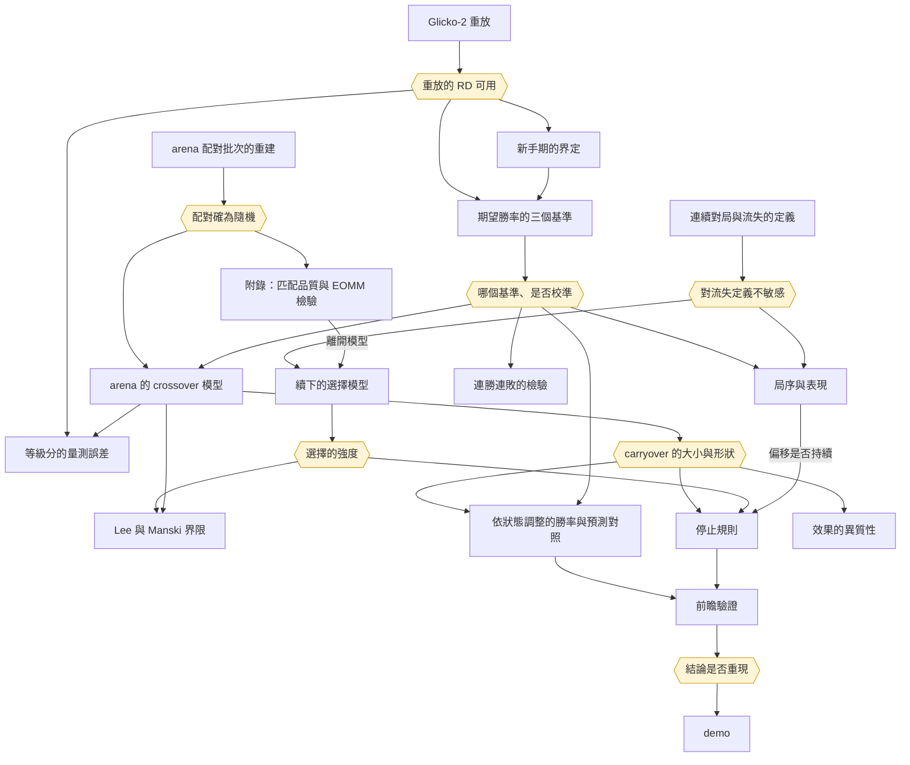

# 分析計劃

方法的優先級、結論之間的依賴、進度與待辦。研究問題見 `docs/design.md`，各方法的模型與升級規則見 `docs/methods.md`。

## 方法清單

優先級分五級：

- **基礎**：其他方法都要用到的定義與資料重建
- **核心**：期望勝率的校準與主問題的識別、推論
- **延伸**：以核心結果為輸入，轉為預測、停止規則或 demo
- **附屬**：附屬問題
- **附錄**：已完成、不在主線但保留於附錄的分析

| 方法 | 解決的問題 | 所需的資料與前置工作 | 優先級 |
|---|---|---|---|
| 連續對局與流失的定義 | 「續下」「離開」「回訪」的操作定義 | 單一 parquet | 基礎（已完成） |
| arena 配對批次的重建 | 每次配對時同時空閒的玩家；permutation test 的打亂範圍 | 單一 parquet | 基礎（已完成） |
| Glicko-2 重放 | 每局對局前的 rating deviation | 單一 parquet、Lichess 的等級分規則 | 基礎（已完成） |
| 新手期的界定 | 新帳號的等級分不準，殘差在新手期不可照字面解讀 | 重放的 rating deviation；累計局數作敏感度分析 | 基礎（已完成） |
| 期望勝率的三個基準 | 期望勝率在哪些對局條件下錯；主問題用哪個基準 | 校準、重放、新手期 | 核心 |
| arena 的 crossover 模型 | 剛輸之後下一局是否低於期望；前一至三局的 carryover | 配對批次、基準 | 核心 |
| 續下的選擇模型 | 下一局只在續下時才有定義；續下率是否隨上一局對手強弱變化 | 流失定義 | 核心 |
| Lee 界限，Manski 界限與 inverse probability weighting 對照 | 續下的選擇下的效果界限 | 選擇模型、crossover 模型 | 核心 |
| 等級分的量測誤差 | 濾波器在剛輸之後是否失準 | 重放的 rating deviation、crossover 模型 | 核心 |
| 依狀態調整的勝率與預測對照 | 修正後的勝和負機率；GAM 與 LightGBM 能改善多少 | 基準、crossover 模型 | 延伸 |
| 停止規則 | 最適停止規則；簡單規則與它的差距 | crossover 模型、選擇模型 | 延伸 |
| 前瞻驗證 | 2014 年的結論在未看過的 2015 年資料上是否重現 | 以上全部；登記文件 | 延伸 |
| demo | 把修正後的勝率與停止規則交給玩家 | 依狀態調整的勝率、停止規則 | 延伸 |
| 效果的異質性 | 效果在玩家間差多少 | crossover 模型 | 附屬 |
| 局序與表現（pattern-mixture） | 第幾局之後開始低於期望 | 基準、流失定義 | 附屬 |
| 連勝連敗的 parametric bootstrap 與一階相依的檢驗 | 連敗是否超出期望勝率的預期 | 基準 | 附屬 |
| rematch 的實測 | 輸後的 rematch 表現；樣本與選擇是否撐得起 | 基準 | 附屬，實測後決定 |
| 隨機配對下匹配品質的效果 | 分差是否影響續下與離開；也是續下模型的來源 | 流失定義、配對批次、校準 | 附錄（已完成） |
| EOMM 關鍵假設的檢驗 | 給定結果，分差是否仍影響離開 | 上一列 | 附錄（已完成） |
| Heliyon 模型的複製與比較 | 觀察資料加固定效應與隨機配對下的估計差多少 | 流失定義、新手期 | 已完成，是否入附錄未定 |
| AoE2 的外部效度 | 「剛輸之後低於期望」在排隊配對中是否同向 | 核心的結果、AoE2 資料與使用條款 | 有餘裕時 |

## 結論之間的依賴

上表的「所需的資料與前置工作」是工作流程上的先後。這一節談的是推論上的依賴：一個方法的結論，決定另一個方法能否做、該怎麼做、結果如何解讀。每個結論都有成立與不成立兩種走向，計劃須兩邊都備妥。

### 會影響其他方法的結論

| 結論 | 由哪個方法得出 | 影響的方法 |
|---|---|---|
| 配對確為隨機：批內雙方等級分無關 | arena 配對批次的重建 | crossover 模型、Lee 界限、附錄的匹配品質效果與 EOMM 檢驗 |
| 期望勝率是否校準、哪個基準最好 | 期望勝率的三個基準 | 幾乎所有方法：表現的基準、勝和負機率、連勝的虛無模型 |
| 重放的 rating deviation 可用 | Glicko-2 重放 | 新手期、三個基準、等級分的量測誤差 |
| 結論對流失定義的門檻是否敏感 | 連續對局與流失的定義 | 選擇模型、局序與表現 |
| carryover 是否不為 0、是否隨對手強弱線性變化 | crossover 模型 | 依狀態調整的勝率、停止規則看「輸」或「爆冷輸」 |
| 續下的選擇有多強 | 選擇模型 | Lee 界限的寬度、多局 carryover 能做到幾局 |
| 偏移是否持續 | 局序與表現 | 是否採用 CUSUM |
| 濾波器在剛輸之後是否失準 | 等級分的量測誤差 | carryover 的解讀 |
| 2014 年的結論是否重現 | 前瞻驗證 | 停止規則與 demo 能否作為建議 |

### 各方法在結論成立與不成立時的走向

| 方法 | 依賴的結論 | 成立時 | 不成立時 |
|---|---|---|---|
| crossover 模型 | 配對確為隨機 | 兩局以上的批以 permutation test 推論 | 一局一批以「下完的時間與等級分無關」為前提，與隨機化推論分開陳述 |
| | 三個基準的結論一致 | 報告主基準，另兩者為敏感度分析 | 如實寫出結論依賴基準 |
| 依狀態調整的勝率 | carryover 不為 0 | 加入上一局結果一項 | 修正後的勝率即基準本身；demo 只給基準的勝率 |
| 停止規則的比較 | carryover 不為 0 | 比較各規則的期望等級分變化 | 各規則的差異只來自期望勝率的錯估；建議為「輸了不必停」 |
| | carryover 隨對手強弱線性 | 規則看輸贏 | 規則只看爆冷輸 |
| Lee 界限 | 續下率隨上一局對手強弱單調變化 | 報告 Lee 界限 | 只報告 Manski 界限 |
| 多局 carryover | 選擇不強到使界限失去資訊 | 報告前一至三局 | 只報告到界限仍有資訊的局數 |
| CUSUM | 局序與表現顯示偏移會持續 | 加入停止規則，誤報率在前瞻資料上驗證 | 不採用 |
| 連勝連敗的 bootstrap | 期望勝率校準 | 以校準後的機率模擬 | 修正後仍不校準時，連勝的「異常」可能只是基準失準，結論不採 |
| 效果的異質性 | 組間交互作用的概似比檢定不拒絕 | 只報告分組結果 | 隨機斜率的 GLMM |
| 貝氏變點模型 | pattern-mixture 曲線有明顯轉折 | 在固定長度的組內估計轉折位置 | 不做 |
| AoE2 的外部效度 | 主問題的 carryover 不為 0 | 檢驗排隊配對中是否同向 | 只作描述 |

### 已得出的結論

| 結論 | 結果 | 所走的路 | 依據 |
|---|---|---|---|
| 期望得分校準 | 不成立：Elo 形式系統性高估強方優勢，老手也一樣；白方有固定優勢；和局機率隨等級上升 | 匹配品質 $q$、勝和負機率、連勝的虛無模型、表現的基準一律改用有序模型的校準期望得分；新手對局排除或讓斜率依累計局數變化。偏差的來源待分解：等級分是 Glicko 濾波器的事後平均，量測誤差屬 Berkson 型，不會使斜率衰減，所以候選來源是濾波器的設定讓等級分過度反應；Glicko-2 重放因此是解釋偏差的必要工作，但不阻擋主分析 | `docs/calibration.md` |
| 配對確為隨機 | 成立，但結構與預期不同：錦標賽第一批之後，絕大多數批次只有兩人同時空閒、只能配成一局，批內沒有可打亂的配法；空閒超過 12 人幾乎只發生在第一批 | randomization inference 只用兩局以上的批次（設計上的隨機）；12 人以下的批以「不含重複對手的配法中均勻抽出」為精確虛無分布；一局一批的配對以「下完的時間與等級分無關」為前提作模型化分析，與隨機化推論分開陳述。退路「只用空閒超過 12 人的批次」不可行 | `docs/random-pairing.md` |
| 對流失定義不敏感 | 大致成立：門檻改變續下率的高低，但除了和局相對於勝負的位置外，描述結論的方向不變 | 以主門檻為主定義，另以主門檻的一半與兩倍重做主要估計；8 小時與 14 天的定義不依賴門檻，直接並列；涉及和局的結論須報告各門檻 | `docs/sessions.md` |
| 新手期的門檻 | 主定義為任一方重放 RD ≥ 110（Lichess 自 2015 年 6 月起標示 provisional 的門檻；2014 年的程式碼沒有這個概念）。RD 門檻約略等於固定的局數，與累計局數的代理高度一致；但校準斜率在 110 處沒有斷點，隨 RD 下降連續上升，到更低的 RD 才趨穩，門檻是約定而非資料的轉折點 | 新手的偏差以加入 RD 的基準吸收，門檻只用於描述與限樣本的敏感度分析；敏感度取 RD ≥ 100 與雙方累計局數皆至少 30 局。arena 的新手對局占比高於 lobby，處理新手對主問題較重要 | `docs/novice-period.md` |
| 匹配品質的總效果 $\gamma$ | 不為 0：隨機配對下，配對越懸殊，短時間窗內的離開越少，兩層識別一致。須以期望匹配品質 $\bar q$ 校正：等級分在候選者中越極端，$q$ 不論配到誰都偏大。效果有一大部分來自懸殊的對局下得較短，時間窗越短效果越大；8 小時離開的效果小，只用純隨機的批時不顯著 | 續下模型改以從對局結束起算的 hazard 模型為主，避免對局長度的機械效果；「越懸殊越少離開」不可解讀為玩家偏好懸殊的配對 | `docs/match-quality-leave.md` |
| 給定結果的直接效果與勝和負不等式 | 關鍵假設不成立：給定本局結果，分差仍影響離開（贏棋後越懸殊越少離開；爆冷輸後離開最多）。$c(\text{勝}) + c(\text{負}) - 2c(\text{和})$ 為正，但假設既不成立，不能推出等實力配對最佳 | 放附錄；主問題的續下模型同樣納入分差與「結果 × 分差」 | `docs/eomm-assumption.md` |
| Heliyon 模型的比較 | 可複製且多數方向可解讀；arena 的分差係數大於大廳，差距的信賴區間不含 0。但大廳的估計對控制自身等級分敏感，控制後直接效果變號，玩家固定效應處理不了等級分起落的混淆；每位玩家的觀察日數少，固定效應 logit 的 incidental parameters 偏誤明顯，效果大小以 conditional logit 或線性機率模型為準 | 「觀察資料加固定效應」在自選對手的情境下不可靠，這是本研究對電競文獻的方法論結論之一；14 天流失的玩家日模型與逐局的隨機配對分析，反應變數、單位與樣本都不同，不能互相驗證 | `docs/fixed-effects-churn.md` |
| 重放重現表頭 | 成立，但須以表頭校正：資料始於 2013 年，此前的 rated 對局不在資料中，從 1500 起的純重放大多不相符；改為每局與表頭取交集、不相容時以表頭重設後，Bullet、Blitz、Classical 絕大多數相符。RD 與 volatility 完全照 lila 的規則重放，以重放的 RD 預測表頭的 RatingDiff 幾乎完全相同 | 重放的 RD 可用於 Glicko-2 形式的期望得分與 provisional 定義的新手期；不相符集中於左截斷帳號的前段、2014 年 pool 試行期的 Bullet 與 Blitz、線上期間的 Classical 與通信棋，這些範圍內的 RD 須謹慎使用 | `docs/glicko-replay.md` |
| 速度類別的修正 | 結論不變：月檔的時間類別是匯出時事後標記的，2015 年 4 月下旬以前部分有加秒的大廳對局被標到慢一級的類別；arena 對局不受影響。各分析改依重放判定的速度類別（`speed`）重跑，主要結論皆未改變 | 後續分析一律依 `speed` 分組；`time_class` 只留作對照 | `docs/speed-class.md` |

這些結論帶出的待查事項：

- **2014 年 11 月底起，一局一批的重複對手驟降為零**：此前大型錦標賽也有重複對手，與原始碼的規則不符；`PairingSystem.scala` 在這段期間沒有修改，可能與錦標賽後端改寫的上線時間有關。若屬實，2014 年的配對機制以 11 月底為界分兩段，須分段檢驗
- **一局一批中執子顏色的輕微偏向**：白方等級分較高的比例略高於一半，原始碼看不出原因，可能與被中止的對局不在資料中有關
- **對局長度的機械效果與總效果的分離**：目前只有每場錦標賽第一局的對局長度（API 的 `createdAt` 與 `lastMoveAt`）。要在所有隨機配對的批次上分開機械效果，須逐局向 API 取得
- **大廳對局仍含指定邀戰與疑似 pool 的對局**：校準與流失定義的「一般對局」都未區分，須以 API 的 `source` 分開後重估

### 依賴圖

方框為方法，六角形為會影響其他方法的結論。

## 進度與待辦

### 已定的原則

- **主問題已定**：期望勝率在哪些情況下錯，與玩家的停止規則（`docs/design.md`）。選題的理由與候選見 `docs/topic-selection.md`
- **方法以基礎形式為先**：分析者修過的方法見 `~/vault/note`（迴歸、數理統計、多變量、貝氏、可靠度、時間序列、機率模式、統計計算）。基礎方法通過診斷即不升級（`docs/methods.md`「方法的升級規則」）。randomization inference 以 permutation test 陳述；conditional logit 與固定效應 logit 以「每組有自己截距的 logistic 迴歸」陳述
- **機器學習與深度學習只用於預測**：不用於因果的結論與停止建議
- **前瞻驗證樣本只用一次**：動用前寫定登記文件
- **帳號以整數代碼分組與串接**：`lichess_games.parquet` 的 `white_id`、`black_id` 與 `player_games.parquet` 的 `player`、`opponent` 是同一套代碼。以帳號字串分組是先前記憶體不足的主因；帳號名稱只在與 API 資料串接時使用
- **一次只跑一個分析**：一個分析能用滿硬體時依序執行，以 `systemd-run --user --scope -p MemoryMax=20G -p MemorySwapMax=0` 加上執行緒數的環境變數限制。熱點先向量化，再考慮 numba，最後才寫 Rust（rayon、faer、fearless_simd、native 編譯；保留 Python 參考實作）

### 已完成

| 分析 | 文件 |
|---|---|
| 期望得分的校準（有序 logistic 對 Elo 形式） | `docs/calibration.md` |
| arena 配對的隨機性 | `docs/random-pairing.md` |
| 連續對局與流失的定義 | `docs/sessions.md` |
| 隨機配對下匹配品質的效果 | `docs/match-quality-leave.md` |
| EOMM 關鍵假設的檢驗 | `docs/eomm-assumption.md` |
| Heliyon 模型的複製與比較 | `docs/fixed-effects-churn.md` |
| Glicko-2 重放 | `docs/glicko-replay.md` |
| 新手期的界定 | `docs/novice-period.md` |
| 速度類別的修正 | `docs/speed-class.md` |

### 進行中

- **2014 年對局的配對來源與對局時間**：`scripts/fetch/lichess_game_meta.py` 以 systemd unit `lichess-game-meta` 在背景執行，arena 對局先、大廳對局後，可續傳，網路錯誤自動重試，行程失敗時 systemd 自動重啟。進度見 `data/raw/lichess-game-meta/fetch.log`。速率由伺服器限制，帶 token 也不會加快。完成後須補寫 `data/raw/lichess-game-meta/SOURCE.md`

### 待辦（依序）

1. **期望勝率的三個基準**：只用 2014 年；三者巢狀於加入 rating deviation 的模型，以修正的概似比檢定比較；先確認 Glicko 形式該用對手的 RD 或雙方合成的 RD。比較完後決定主基準，在估計 crossover 模型之前寫定
2. **已完成分析的檢定改為修正的概似比檢定**：`scripts/calibration.py`、`scripts/eomm_assumption.py`、`scripts/fixed_effects_churn.py` 中以 sandwich Wald 作決策的檢定，改為以 dyadic 或玩家相依修正的概似比檢定，做不到時用 robust score 檢定；delta method 的區間不變
3. **arena 的 crossover 模型**：總效果、前一至三局的 carryover、劑量反應、平衡檢驗
4. **續下的選擇模型**：本場內是否再開一局的 logistic 迴歸；競爭風險的 hazard 待 arena 的對局結束時間取得
5. **Lee 界限**，與 Manski 界限、inverse probability weighting、有參數的敏感度分析並報
6. **等級分的量測誤差**：依 RD 與上一局結果分層的校準；改變 τ 重放
7. **局序與表現**：pattern-mixture 曲線；有明顯轉折才做變點
8. **依狀態調整的勝率與預測對照**：GAM、LightGBM
9. **停止規則**：Markov chain 上的最適規則與簡單規則；偏移持續時加 CUSUM
10. **附屬**：連勝連敗的檢驗、效果的異質性、rematch 的實測
11. **前瞻驗證的登記文件**，之後才動用 2015 年 1 月 1 日至 4 月 19 日的 arena
12. **demo**
13. **附錄**：以對局結束起算的 hazard 模型扣除匹配品質效果中的對局長度機械效果
14. **有餘裕時**：AoE2 的外部效度

## 執行上的判斷

- **先做會左右最多方法的結論**：基準與配對是否隨機影響幾乎所有方法；配對的隨機性已確認，基準剩三者的比較
- **carryover 是樞紐**：依狀態調整的勝率與停止規則都依賴它的大小與形狀
- **選擇偏誤是評分時會被重點檢視的一環**：inverse probability weighting 的假設會把 tilt 一併假設掉，所以界限為主、IPW 為對照
- **輸棋本身的效果多一個假設**：上一局對手只經由結果影響下一局。附錄的 EOMM 檢驗發現對手經由結果以外的途徑影響離開，這個假設同樣可能不成立，所以總效果為主、比值為解讀
- **方法的定位事先寫定**：條件保留與退路的觸發條件寫在 `docs/methods.md`「方法的升級規則」，不看結果再挑方法
- **前瞻驗證之前不得反覆修改模型**：2014 年內可反覆，登記之後只跑一次
